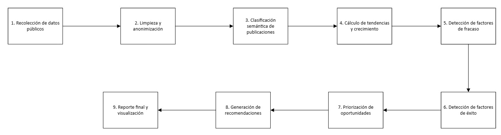

# CreativIA: RADAR DE CONTENIDO

**DOCUMENTO DE INVESTIGACIÓN Y PLANTEAMIENTO**

*Por: Mariana Amaya Ramos, Valentina Garzón Peña y Carolina Ujueta Ricardo*

## RESUMEN

El presente proyecto aborda el desafío de identificar tendencias emergentes en redes sociales de manera confiable y a bajo costo, con el propósito de mejorar la planificación de contenidos de 30X, una escuela de negocios dirigida a emprendedores y líderes empresariales en Latinoamérica. Ante los elevados costos de las herramientas de monitoreo, las restricciones de acceso a información pública y la dificultad para interpretar el rendimiento de las publicaciones, se desarrolla CreativIA: Radar de contenido, un prototipo que integra información de fuentes públicas como Bluesky, Hacker News, Google News y YouTube, complementada con el ingreso asistido de publicaciones de otras plataformas. Mediante técnicas de análisis de datos y modelos de inteligencia artificial, el sistema clasifica contenidos según su temática, gancho y formato, analiza indicadores de interacción y crecimiento, identifica patrones asociados al rendimiento y prioriza oportunidades según su relevancia para la audiencia. Finalmente, genera recomendaciones editoriales orientadas a facilitar la toma de decisiones sobre qué contenidos producir, buscando ofrecer una alternativa económica y automatizada que respete las restricciones de acceso y privacidad de las plataformas digitales.

**Palabras clave:** inteligencia artificial, detección de tendencias, análisis de contenido, redes sociales, inteligencia de medios, automatización editorial.

## I. INTRODUCCIÓN

En un entorno digital caracterizado por la constante generación de contenido y la rápida evolución de las tendencias, identificar oportunamente qué temas están ganando relevancia se ha convertido en un desafío para los equipos de comunicación y medios. Aunque existen herramientas que permiten monitorear publicaciones e interacciones en redes sociales, sus costos, las restricciones de acceso a la información y la dificultad para interpretar los factores asociados al éxito de los contenidos limitan su utilidad para la toma de decisiones editoriales.

En este contexto, 30X, una escuela de negocios enfocada en el desarrollo de emprendedores y líderes empresariales en Latinoamérica, enfrenta el reto de identificar tendencias emergentes relacionadas con inteligencia artificial, comprender qué características favorecen el rendimiento de las publicaciones y determinar su relevancia para una audiencia específica. Esta necesidad cobra mayor importancia ante la expansión de la organización hacia nuevos mercados y la búsqueda de alternativas que reduzcan los costos y la dependencia de herramientas externas.

Como respuesta a esta problemática, se desarrolla CreativIA: Radar de contenido, un prototipo que combina fuentes públicas de información, técnicas de análisis de datos y modelos de inteligencia artificial para clasificar publicaciones, identificar señales de crecimiento, analizar patrones de interacción y priorizar oportunidades de contenido. El sistema integra información de fuentes abiertas como Bluesky, Hacker News, Google News y YouTube, y contempla el ingreso asistido de publicaciones de otras plataformas, respetando las restricciones de acceso y privacidad. A partir de estos datos, genera recomendaciones editoriales orientadas a facilitar la planificación de contenidos relevantes para la audiencia de 30X.

## II. MARCO TEÓRICO

### 2.1. Acceso a la información

El acceso a contenido público de YouTube, Instagram, Tiktok y LinkedIn desde Colombia es muy desigual entre plataformas. YouTube es la única que ofrece una vía oficial, gratuita y automatizable para consultar contenido de terceros sin trámites especiales. En las otras tres, el acceso a contenido de terceros es restringido o inexistente, por lo que el diseño debe combinar una fuente automática con mecanismos asistidos por personas. Todas las vías que se describen a continuación se limitan a contenido público y excluyen datos personales (Esto respondiendo a las restricciones del reto).

- **Youtube:** La vía principal es Youtube Data API v3, que permite consultar metadatos, vistas, likes y comentarios de videos y canales público. Por defecto, cada proyecto dispone de 10.000 unidades diarias para la mayoría de los endpoints y de un cupo separado de 100 llamadas diarias a la búsqueda por palabra clave (Search.list), la mayoría de las lecturas de videos, canales y listas de reproducción cuesta una unidad. (Google for Developers, s. f.-c)

Por lo anterior, conviene descubrir canales con búsquedas ocasionales y monitorearlos después con consultas a sus listas de reproducción de subidas, que es lo que la documentación recomienda en lugar de la búsqueda para obtener los videos recientes de un canal. (Google for Developers, s. f.-b)

La API permite filtrar los resultados por región y por idioma (Google for Developers, s. f.-b). Como complemento sin costo de cuota, cada canal expone un feed RSS (Really Simple Syndication es un archivo en formato XML para que otros programas puedan leerlos sin entrar a la página) con sus videos más recientes, el servicio oEmbed entrega datos básicos en un enlace público y el listado de videos populares por país permite ver tendencias generales. Si se necesita más cuota que la asignada por defecto se debe completar primero una auditoría de cumplimiento de los términos de servicio de las APIs de Youtube mediante el formulario oficial. (Google for Developers, s. f.-a)

- **Instagram:** La API de Meta funciona con cuentas profesionales (de negocio o de creador). Permite obtener métricas e insights de las cuentas propias, aunque algunas métricas no están disponibles para cuentas con menos de 100 seguidores (Meta for Developers, s. f.-d).

Para cuentas de terceros existen dos funciones con restricciones: Business Discovery, que devuelve metadatos y métricas básicas de otras cuentas profesionales de Instagram (Meta for Developers, s. f.-c), y la búsqueda por hashtag, que permite consultar un máximo de 30 en una ventana móvil de 7 días, exige lo mismo (Una cuenta de negocio o de creador) (Meta for Developers, s. f.-e). Ambas requieren registrar una aplicación de Meta (Meta for Developers, s. f.-f). La meta Content Library, que ofrece un archivo amplio de contenido público de Instagram y Facebook, no es una opción viable para este proyecto: Meta acepta solicitudes de investigadores de todo el mundo, siempre que cumplan los requisitos (Meta for Developers, s. f.-a), pero exige afiliación con una universidad y organización sin ánimo de lucro dedicada a la investigación (Meta Transparency Center, 2026). Las vías complementarias sin permisos especiales son el ingreso asistido de publicaciones y métricas visibles de cuentas de referencia

- **Tiktok:** La Research API ofrece metadatos de videos públicos, comentarios y perfiles, pero según la documentación oficial está dirigida a investigadores de universidades sin ánimo de lucro de Estados Unidos y Europa (TikTok for Developers, s. f.-b), requiere cumplir criterios de elegibilidad y tener un proyecto de investigación específico aprobado (una cuenta de desarrollador no basta) (TikTok for Developers, s. f.-a) y a la fecha de esta consulta, no hay confirmación de que cubra a Colombia, pues TikTok solo indica que espera ampliar la elegibilidad a otras regiones (TikTok for Developers, s. f.-a), por eso no se considera viable para este proyecto.
- **LinkedIn:** LinkedIn no permite el uso de software de terceros, como rastreadores, bots, extensiones o complementos del navegador, que extraigan datos, modifiquen el sitio o automaticen actividad, lo considera una violación de su Acuerdo de Usuario (sección 8.2) y declara que trabaja en medidas técnicas contra el scraping (LinkedIn Help, s. f.); por eso se excluyen las extensiones, los bots, los proxies y los proveedores de datos de perfiles, que además implicarían tratar datos personales.
- **Ingreso asistido (todas las redes):** Para las plataformas sin acceso automatizable a contenido de terceros, la vía más defendible es el ingreso asistido, que no interactúa con ninguna plataforma. El equipo de 30X y su audiencia registran piezas públicas desde el botón «Aportar» de la aplicación (o un archivo CSV): enlace, texto visible, fecha y métricas visibles. El sistema exige confirmar que la pieza es pública, elimina menciones, correos y teléfonos antes de guardar, no almacena el nombre del autor y, a partir de esos datos, calcula rendimiento relativo, ciclo de vida de la tendencia y relevancia para la audiencia. Como mejora futura, un modelo con capacidad de visión podría extraer esos datos desde una captura de pantalla. Todo esto va en línea con la restricción del reto y con la Ley Estatutaria 1581 de 2012 de protección de datos personales (Congreso de la República de Colombia, 2012). Este método evita el scraping, cubre las cuatro redes tal como las ven personas reales y llega ya filtrado por la audiencia relevante, aunque tiene un volumen limitado y un sesgo propio de quienes participan, que debe declararse.

Como consecuencia, en Colombia solo YouTube permite una recolección automática de contenido de terceros mediante una API oficial sin permisos especiales (Google for Developers, s. f.-c). Los resultados sobre LinkedIn, TikTok e Instagram de terceros se apoyarán en las piezas que la comunidad registre y en las cuentas de referencia que el equipo ingrese, por lo que deben interpretarse como una muestra y no como una medición de toda la red.

Además de las cuatro redes del reto, existen fuentes abiertas que permiten detectar temas de IA cuando apenas empiezan a circular, antes de llegar a Instagram o TikTok. Todas son públicas, no requieren iniciar sesión y se consultan por vías documentadas, por lo que cumplen las restricciones del reto. Son las que usa el prototipo construido:

- **Bluesky:** red social abierta construida sobre el protocolo AT. Su servicio público (AppView) permite buscar publicaciones por palabra clave, idioma y rango de fechas con el método app.bsky.feed.searchPosts, sin registro ni clave, y devuelve el texto, la fecha y las interacciones (me gusta, compartidos, respuestas y citas) (roccopaz, s. f.). Es la fuente principal de conversación social del prototipo, en español e inglés.
- **Hacker News:** comunidad de tecnología cuyo buscador oficial (API de Algolia) es público y gratuito. Permite consultar historias por palabra clave y por rango de fechas, con puntos y número de comentarios [37]. Sirve como señal temprana: muchos temas de IA aparecen allí días o semanas antes de llegar al público general.
- **Google News (RSS):** el feed público de búsqueda de Google News devuelve titulares recientes por consulta, idioma y país (por ejemplo, español para Colombia o México) [38]. No trae interacciones, pero mide cuánto se habla de un tema en medios. Como cada consulta devuelve como máximo unos 100 resultados, se consulta día por día para no sesgar la medición hacia los días más recientes.
- **YouTube (RSS por canal):** además de la Data API descrita arriba, cada canal tiene un feed RSS oficial con sus 15 videos más recientes, sus vistas y valoraciones, sin cuota ni clave. El prototipo lo usa para seguir canales de referencia (por ejemplo, Dot CSV, Platzi, OpenAI, Anthropic o Google DeepMind).

Para analizar la información, el prototipo combina un clasificador y un modelo generativo:

- **Jev (TypeSafe):** modelo de decisiones (“System One”) que recibe un estado (el texto de una publicación) y varias preguntas tipadas, y devuelve respuestas estructuradas con probabilidades calibradas: una opción de una lista (Choice), un puntaje en una escala (Score) o una probabilidad de sí o no (Noul). No genera texto, por lo que no puede inventar información, aunque sí puede equivocarse. Cuesta US$0,042 por millón de tokens de entrada y las respuestas son gratuitas. El prototipo quedó integrado con Jev por tres vías: una clave propia de TypeSafe (console.typesafe.ai), DigitalOcean Serverless Inference (modelo typesafe-jev-1.13.0) y OpenRouter. Sin embargo, durante la hackatón ninguna cuenta del equipo obtuvo acceso: DigitalOcean respondió que el modelo no está disponible para el nivel de la cuenta y la clave de OpenRouter no tenía saldo. Por eso las corridas del prototipo usaron el clasificador local descrito a continuación. Jev se activa sin cambios en el código en cuanto haya una clave con acceso, y si deja de responder, el sistema lo detecta y vuelve al clasificador local.
- **Clasificador local (usado en el prototipo):** modelo de embeddings multilingüe (paraphrase-multilingual-MiniLM-L12-v2) que corre en el propio computador, sin claves, sin costo y sin enviar datos a terceros. Compara el significado de cada publicación con la descripción de cada tema y de la audiencia; el gancho, el formato y el tipo de publicador se detectan con reglas. Es menos preciso que Jev: el encaje con la audiencia es relativo a la muestra (percentil) y no una probabilidad calibrada.
- **Modelos open source vía OpenRouter:** modelo generativo que se usa solo para redactar, a partir de las señales que ya calculó el sistema, el ángulo editorial, los ganchos y el formato recomendado para cada tema. Se usa Nemotron 3 Super de NVIDIA, de pesos abiertos y gratuito, y DeepSeek V4.1 Flash (también de pesos abiertos, menos de un centavo por reporte) como respaldo. Claude (Anthropic) queda como alternativa opcional, y sin ningún modelo el prototipo arma las recomendaciones con plantillas. Para no inventar datos, el modelo tiene prohibido crear cifras y escribe [dato por verificar] donde haría falta una.

### 2.2. Accesibilidad a las redes sociales

| Red | Facilidad | Cómo se accede | Requisito clave | Tiempo |
|---|---|---|---|---|
| Youtube | Fácil | Api oficial de datos | Proyecto en google Cloud | Horas |
| Instagram | Media | Api de Meta (Business Discovery y hashtags) | Cuenta profesional, app de meta y token | Horas en modo desarrollo, semanas para acceso avanzado |
| TikTok | Difícil | Creative Center manual, o autorización de creadores | Aprobación de TikTok para Login Kit y Display API | Semanas (API), Inmediato (manual) |
| LinkedIn | Muy difícil | Sin vía abierta para contenido de terceros | Ser administrador de la página y pasar revisión | No viable |
| Bluesky | Muy fácil | API pública (AppView), búsqueda por palabra clave | Ninguno: sin cuenta ni clave | Inmediato |
| Hacker News | Muy fácil | API pública de Algolia | Ninguno | Inmediato |
| Google News | Muy fácil | Feed RSS de búsqueda por país e idioma | Ninguno (sin métricas de interacción) | Inmediato |
| Comunidad 30X (las 4 redes) | Fácil | Ingreso asistido: enlace, texto o captura de piezas públicas | Participación del equipo y la comunidad | Inmediato (volumen limitado) |

La tabla muestra que la facilidad de acceso es inversa al interés del reto: las redes donde 30X más publica (Instagram, TikTok y LinkedIn) son las más cerradas, mientras que las fuentes abiertas (Bluesky, Hacker News, Google News y los feeds de YouTube) se pueden conectar en minutos. En la práctica, el prototipo se conectó a las cuatro fuentes abiertas el mismo día, sin registrarse en ninguna plataforma ni pagar, y en una sola corrida reunió 3.300 piezas públicas de las últimas tres semanas en unos 17 segundos.

Por eso la estrategia es combinar dos vías. La automática, con fuentes abiertas, mide la conversación y detecta temas temprano. La asistida, con la comunidad, aporta piezas concretas de Instagram, TikTok y LinkedIn mediante el botón «Aportar» de la aplicación o un archivo CSV (red, enlace, texto, fecha y métricas visibles), sin automatizar nada dentro de esas plataformas. Si más adelante se obtiene acceso aprobado a la API de Meta o a la YouTube Data API con cuota ampliada, se pueden agregar como fuentes nuevas sin cambiar el resto del sistema.

### 2.3. Herramientas para la solución

El prototipo, llamado creativIA - Radar de contenido, se construyó con herramientas abiertas o de muy bajo costo. Su código está publicado en GitHub. La siguiente tabla resume qué se usa en cada parte y cuánto cuesta:

| Herramienta | Para qué se usa | Costo |
|---|---|---|
| Python 3.12 y httpx | Lenguaje del prototipo y consultas a las fuentes en paralelo | Gratis |
| Bluesky, Hacker News, Google News y RSS de YouTube | Recolección de piezas públicas sobre IA, en español e inglés | Gratis |
| Botón «Aportar» y CSV de comunidad | Ingreso asistido de piezas de Instagram, TikTok y LinkedIn | Gratis |
| Jev (TypeSafe), vía TypeSafe, DigitalOcean u OpenRouter (integrado; sin acceso durante la hackatón) | Clasificar cada pieza: tema, gancho, formato, publicador, encaje con la audiencia, si es accionable, técnica, humo o de LatAm | US$0,042 por millón de tokens (≈ US$0,10 por corrida de 3.000 piezas, estimado) |
| Clasificador local (fastembed, MiniLM multilingüe) | Clasificar cada pieza cuando Jev no está disponible; es el que usaron las corridas del prototipo | Gratis |
| Nemotron 3 Super y DeepSeek V4.1 Flash vía OpenRouter (open source) | Redactar el ángulo, tres ganchos y el formato por plataforma de cada tema | Gratis con Nemotron; con DeepSeek, menos de un centavo por reporte |
| Caché local (JSONL) | No volver a pagar por piezas ya clasificadas | Gratis |
| App web local y reportes HTML, Markdown y JSON | Entregar el resultado al equipo de media; se ve bien en celular | Gratis |
| GitHub | Código, historial y documentación del proyecto | Gratis |

La división de trabajo entre los modelos es deliberada. El clasificador (hoy el modelo local; Jev cuando haya acceso) toma decisiones cerradas y baratas sobre miles de piezas, con probabilidades que se pueden sumar y comparar. El modelo generativo solo escribe al final y sobre unos pocos temas ya priorizados. Todos los cálculos (conteos, crecimiento, pesos) se hacen en código y no en los modelos, como recomienda la documentación de TypeSafe [40]. Así cada resultado se puede revisar y ajustar, y el costo total de operación es hoy de cero dólares (y de centavos por semana si se activa Jev), frente a los miles de dólares al año que cuestan las herramientas de social listening.

### 2.4. 30X cultura organizacional

30X es una escuela de negocios fundada por Andrés Bilbao, Daniel Bilbao y Dylan Rosemberg, que se presenta como una alternativa al MBA tradicional, ofreciendo inmersiones cortas, intensivas y prácticas en lugar de programas prolongados centrados en la teoría. Su cultura organizacional prioriza la ejecución, la rapidez, la innovación y la aplicación inmediata del conocimiento, promoviendo el aprendizaje a partir de experiencias reales de emprendedores y ejecutivos (30X, s. f.-a). Para la empresa, el contenido digital no es simplemente un complemento, sino uno de sus principales motores de posicionamiento y atracción de clientes. Andrés Bilbao ha construido una marca personal con gran reconocimiento en Instagram y TikTok mediante un sistema estructurado de producción de contenido basado en tres elementos: identificar qué hace efectiva una marca personal, encontrar un ángulo diferenciador incluso en mercados saturados y desarrollar estrategias paso a paso para cada red social (30X Team, s. f.). Sus contenidos se concentran en emprendimiento, inteligencia artificial, negociación, ventas y crecimiento empresarial. Asimismo, 30X proyecta una cultura austera, orientada a la eficiencia y al cuestionamiento de herramientas costosas que no ofrecen soluciones completas, promoviendo alternativas prácticas y el uso de inteligencia artificial. Sin embargo, su elevada exposición pública también representa desafíos reputacionales, especialmente por controversias en redes sociales relacionadas con sus fundadores, como la polémica de 2026 sobre una convocatoria laboral sin remuneración (Ospina, 2026).

### 2.5. Público objetivo de 30X

El público objetivo de 30X está conformado principalmente por emprendedores, fundadores de startups, empresarios, directores ejecutivos y profesionales con responsabilidades de liderazgo que buscan desarrollar, consolidar o escalar sus negocios. Desde una perspectiva demográfica, se estima un rango de edad aproximado entre los 25 y 50 años, aunque esta segmentación es una propuesta analítica y no un dato oficial de la empresa. Desde una perspectiva psicográfica, se dirige a personas con mentalidad emprendedora, orientación a resultados, interés por la innovación, disposición al aprendizaje continuo y preferencia por soluciones prácticas frente a la formación exclusivamente teórica. Su audiencia busca adquirir conocimientos aplicables en inteligencia artificial, marketing, ventas, negociación y crecimiento empresarial, además de establecer conexiones estratégicas con otros emprendedores y ejecutivos. Geográficamente, se enfoca principalmente en Latinoamérica y en profesionales interesados en mejorar la competitividad y eficiencia de sus empresas (30X, s. f.-b; 30X, s. f.-c).

## III. PLANTEAMIENTO DEL PROBLEMA

### 3.1. Presente y futuro del problema

Tradicionalmente, los equipos de creación de contenido identificaban tendencias mediante la revisión manual de referentes y decisiones basadas en la intuición. Posteriormente, surgieron herramientas de social listening y scraping que permitieron automatizar la recolección de datos, aunque con costos asociados y restricciones de acceso a la información de las plataformas. Actualmente, estas limitaciones continúan siendo relevantes: YouTube establece cuotas de uso para su API, mientras que TikTok restringe el acceso a su Research API a investigadores que cumplan requisitos específicos, excluyendo su utilización comercial directa (Google for Developers, s. f.; TikTok for Developers, 2026). En este contexto, 30X enfrenta una problemática que va más allá de recolectar información: aunque actualmente paga por herramientas que le permiten conocer qué contenido se publica, necesita responder tres preguntas estratégicas: si una tendencia está comenzando o ya se encuentra saturada, por qué una publicación logró buenos resultados y si ese contenido es relevante para su audiencia. A esto se suma su expansión hacia mercados como México, Estados Unidos, Argentina y España, que incrementa la necesidad de identificar tendencias relevantes para públicos con características culturales, intereses y comportamientos digitales diferentes.

Hacia el futuro, si esta problemática no se resuelve, 30X podría enfrentar mayores costos de análisis a medida que crezca, mantener su dependencia de proveedores externos y continuar identificando tendencias cuando estas ya han sido ampliamente replicadas. Por el contrario, desarrollar una herramienta propia de inteligencia de contenido permitiría anticipar oportunidades, comprender los factores asociados al rendimiento de las publicaciones y priorizar temas según su relevancia para cada mercado. Esto podría convertirse en una ventaja competitiva y, eventualmente, en un producto comercializable para emprendedores y creadores de contenido de su comunidad. Esta oportunidad resulta especialmente relevante por los avances recientes en inteligencia artificial, incluyendo modelos especializados en clasificación como JEV, que permiten evaluar grandes volúmenes de información mediante preguntas cerradas y probabilidades, con costos de procesamiento reducidos (Badías, 2026). No obstante, su aplicación requeriría complementar la clasificación con análisis temporal de tendencias, métricas de interacción y mecanismos de acceso a datos que respeten las condiciones de cada plataforma.

### 3.2. Stakeholders y sus necesidades

| Stakeholder | Necesidades y expectativas | Fuente |
|---|---|---|
| Equipo de media de 30X (usuario directo) | Identificar tendencias emergentes, comprender por qué funcionan determinados contenidos y decidir semanalmente qué producir, reduciendo el tiempo dedicado a la búsqueda y el análisis manual. | Diagnóstico del proyecto (elaboración propia). |
| Andrés Bilbao y demás fundadores | Fortalecer sus marcas personales, mantener su posicionamiento digital, proteger su reputación y garantizar que el contenido contribuya al crecimiento de 30X. | 30X (s. f.-a); diagnóstico del proyecto. |
| Asesores y estrategas de contenido | Recibir tendencias filtradas, métricas de desempeño e información útil para desarrollar publicaciones alineadas con la identidad de marca y el sistema de producción de contenido. | Diagnóstico del proyecto (elaboración propia). |
| Dirección de 30X | Reducir costos de herramientas externas, mejorar la eficiencia operativa, disminuir la dependencia de proveedores de datos y generar ventajas competitivas mediante tecnología propia. | Diagnóstico del proyecto (elaboración propia). |
| Equipos comerciales y de expansión | Contar con contenido atractivo y relevante para captar clientes potenciales, fortalecer la presencia de marca y adaptar la comunicación a diferentes mercados internacionales. | 30X (s. f.-a); diagnóstico del proyecto. |
| Audiencia final: emprendedores, ejecutivos y líderes empresariales | Acceder a contenido actualizado, práctico y confiable sobre inteligencia artificial, emprendimiento, ventas, liderazgo y crecimiento empresarial, que responda a sus intereses y necesidades profesionales. | 30X (s. f.-a). |
| Comunidad de alumnos de 30X | Acceder a conocimientos aplicables, compartir experiencias y establecer conexiones profesionales. También puede aportar retroalimentación para identificar intereses y necesidades emergentes. | 30X (s. f.-b). |
| Creadores de contenido y referentes digitales | Que sus publicaciones sean analizadas respetando su autoría, sus derechos y su privacidad, evitando la reproducción o utilización indebida de su contenido. | Google for Developers (s. f.). |
| Plataformas digitales (YouTube, Instagram y TikTok) | Garantizar que la recopilación y utilización de información cumpla sus políticas de acceso, límites de uso, privacidad y protección de datos. | Google for Developers (s. f.); políticas de cada plataforma. |

El principal desafío de 30X no consiste únicamente en acceder a información sobre contenidos publicados en redes sociales, sino en transformar esos datos en conocimiento útil para tomar decisiones editoriales oportunas y fundamentadas. La investigación realizada evidenció que, aunque existen herramientas comerciales capaces de recopilar grandes volúmenes de información, sus elevados costos, las restricciones de acceso a determinadas plataformas y la falta de análisis sobre el ciclo de vida de las tendencias limitan su capacidad para responder a las necesidades de la organización. Además, la expansión de 30X hacia nuevos mercados incrementa la importancia de identificar contenidos relevantes para audiencias con características e intereses diferentes. Los antecedentes y referentes técnicos analizados muestran que la combinación de fuentes públicas, métodos estadísticos e inteligencia artificial ofrece oportunidades para detectar tendencias emergentes, reconocer patrones asociados al rendimiento de las publicaciones y generar recomendaciones editoriales a bajo costo. En este contexto, se plantea la siguiente pregunta problema: **¿Cómo desarrollar una solución de inteligencia de contenido que, mediante el análisis de datos públicos y el uso de inteligencia artificial, permita a 30X identificar oportunamente tendencias emergentes, comprender los factores asociados al éxito de las publicaciones y priorizar oportunidades de contenido relevantes para su audiencia, de manera confiable, automatizada y económicamente viable?**

### 3.3. Requerimientos

1. **Acceso a información pública:** El sistema debe permitir recopilar información de publicaciones mediante fuentes abiertas y mecanismos autorizados, como las API de Bluesky y Hacker News, y los feeds RSS de Google News y YouTube. Para plataformas con acceso restringido, como Instagram, TikTok y LinkedIn, se contempla el ingreso asistido de publicaciones públicas, respetando las condiciones de uso de cada plataforma.
1. **Herramientas de inteligencia artificial:** Se requiere integrar modelos de inteligencia artificial que permitan clasificar publicaciones según su temática, gancho, formato y relevancia para la audiencia. El prototipo clasifica con un modelo local gratuito, deja integrado Jev para clasificaciones estructuradas cuando haya acceso y usa modelos open source vía OpenRouter para generar recomendaciones editoriales.
1. **Procesamiento y almacenamiento de datos:** El sistema debe permitir limpiar, organizar, estandarizar y almacenar la información recopilada de diferentes fuentes, eliminando duplicados y gestionando datos incompletos. También debe conservar resultados de clasificaciones anteriores mediante un sistema de caché para evitar procesamientos repetidos y reducir costos.
1. **Análisis de tendencias e interacciones:** Se requiere implementar métodos estadísticos que permitan comparar publicaciones entre diferentes periodos, calcular indicadores de crecimiento, aceleración e interacción e identificar la etapa de desarrollo de las tendencias. Asimismo, el sistema debe analizar características asociadas al rendimiento de las publicaciones, como los ganchos, formatos y tipos de publicador.
1. **Evaluación y priorización de contenidos:** El sistema debe permitir identificar qué tendencias son relevantes para la audiencia de 30X, considerando factores como el crecimiento, las interacciones, la utilidad práctica y la alineación con los intereses de emprendedores y líderes empresariales latinoamericanos. Estos criterios deben integrarse en un sistema de puntuación para priorizar oportunidades de contenido.
1. **Visualización de resultados:** Se requiere una interfaz que presente las tendencias identificadas, sus indicadores, publicaciones de referencia y recomendaciones editoriales de manera clara y comprensible. El prototipo incluye una aplicación web local y genera reportes en formatos HTML, Markdown y JSON para facilitar su consulta y apoyar la toma de decisiones del equipo de media.
1. **Seguridad, privacidad y protección de datos:** El sistema debe garantizar que únicamente se recopile y analice información pública, sin acceder a datos privados ni revelar información personal de los usuarios. Para ello, el prototipo incorpora mecanismos de anonimización mediante identificadores hash para los autores y limpieza de textos para eliminar menciones a usuarios, correos electrónicos y números telefónicos antes de almacenar o procesar la información mediante modelos de IA. Asimismo, debe respetar los términos de servicio de las plataformas y la normativa aplicable sobre protección de datos personales, incluyendo la Ley 1581 de 2012 en Colombia.
1. **Bajo costo y eficiencia operativa:** La solución debe aprovechar herramientas gratuitas o de bajo costo, optimizando las consultas a fuentes externas y el uso de modelos de inteligencia artificial. Se debe considerar el almacenamiento en caché y el procesamiento eficiente para reducir los costos operativos y ofrecer una alternativa económicamente viable frente a las herramientas comerciales de monitoreo de contenido.
1. **Confiabilidad y trazabilidad:** Los resultados deben basarse en información verificable, conservando la referencia de las publicaciones, las fechas de recopilación y los criterios utilizados en los análisis. Es necesario reconocer las limitaciones de las fuentes, los posibles sesgos de las muestras y la incertidumbre asociada a las tendencias identificadas, evitando presentar conclusiones que no estén respaldadas por los datos disponibles.

## IV. JUSTIFICACIÓN

El desarrollo de CreativIA: Radar de contenido surge de la necesidad de transformar grandes volúmenes de información pública en conocimiento útil para la toma de decisiones editoriales. En un entorno digital donde las tendencias evolucionan rápidamente, identificar contenidos populares no es suficiente, también es necesario comprender su crecimiento, reconocer los factores asociados a su rendimiento y determinar su relevancia para una audiencia específica. En este sentido, el proyecto se justifica desde tres perspectivas: tecnológica, empresarial y de valor para los usuarios finales.

Desde la perspectiva tecnológica, el proyecto demuestra el potencial de combinar fuentes abiertas de información, técnicas de análisis estadístico y modelos de inteligencia artificial para desarrollar una solución de inteligencia de contenido de bajo costo. A través de la automatización de la recopilación de datos, la clasificación de publicaciones (con un clasificador local gratuito, y con Jev cuando haya acceso) y el análisis de indicadores de crecimiento e interacción, CreativIA busca convertir datos dispersos en oportunidades de contenido fundamentadas. Además, su arquitectura permite integrar diferentes fuentes de información y utilizar modelos especializados para tareas específicas, optimizando los recursos computacionales y reduciendo la dependencia de herramientas comerciales. Este desarrollo también representa una oportunidad para explorar métodos de detección temprana de tendencias, análisis del rendimiento de publicaciones y generación de recomendaciones mediante IA, respetando las restricciones de acceso y protección de datos de las plataformas.

Desde la perspectiva empresarial, creativIA responde a una necesidad del equipo de media de 30X: identificar oportunamente qué contenidos producir sin invertir grandes cantidades de tiempo y dinero en su búsqueda y análisis. Actualmente, la organización depende de herramientas externas que representan costos elevados y no ofrecen una interpretación completa de la información recopilada. La implementación de una solución propia podría reducir esta dependencia, agilizar la planificación editorial y facilitar decisiones basadas en indicadores verificables. Asimismo, permitiría priorizar contenidos alineados con los intereses de su audiencia y fortalecer la estrategia de comunicación de la empresa en su proceso de expansión hacia nuevos mercados latinoamericanos e internacionales.

Finalmente, desde la perspectiva de los clientes y usuarios finales, el proyecto busca contribuir a la creación de contenido más relevante, oportuno y útil para emprendedores, ejecutivos y equipos empresariales interesados en la aplicación práctica de la inteligencia artificial. Al identificar temas emergentes y evaluar su pertinencia, 30X podría ofrecer información que responda mejor a las necesidades de aprendizaje y actualización de su audiencia, evitando depender exclusivamente de la popularidad de las publicaciones. Adicionalmente, la metodología desarrollada tiene potencial para ser utilizada por otros creadores de contenido, emprendedores y organizaciones que enfrentan dificultades similares para identificar oportunidades en redes sociales.

## V. ANTECEDENTES

Jagran New Media, es una solución de análisis de datos que permite a los equipos editoriales comprender el comportamiento de su audiencia y mejorar la planificación de contenidos. Fue desarrollada utilizando herramientas como Google BigQuery, Google Data Studio y Google Tag Manager, que permiten recopilar, organizar y visualizar información sobre el rendimiento de las publicaciones. Si bien esta solución no recopila información pública de redes sociales externas mediante API, sino que analiza datos propios sobre el comportamiento de sus lectores, resulta útil para el reto 30X por tres aspectos principales: **1. Segmentación de audiencias**: Jagran dividió a sus lectores en cuatro segmentos para identificar qué contenidos generaban mayor interés en cada grupo, analizando sus patrones de consumo; este enfoque podría aplicarse en 30X para diferenciar, por ejemplo, contenidos de IA relevantes para líderes empresariales frente a aquellos dirigidos a equipos técnicos. **1. Indicadores de engagement:** en lugar de evaluar únicamente las visualizaciones, incorporaron métricas como la tasa de finalización de artículos (lectores que alcanzan al menos el 75% del contenido), la tasa de recirculación (lectores que continúan navegando hacia otros artículos) y la duración de las sesiones. Para 30X, este enfoque permitiría considerar indicadores complementarios, como la proporción de comentarios o interacciones respecto a las visualizaciones, para evaluar el rendimiento de las publicaciones. **3. Dashboard de análisis:** desarrollaron un tablero interactivo para visualizar estas métricas por segmentos de audiencia, identificar patrones de comportamiento y facilitar decisiones editoriales sobre qué contenidos producir. Además, **optimizaron la infraestructura de procesamiento de datos**, logrando reducir en un 95% los costos asociados a las consultas y el procesamiento, lo cual constituye un referente para desarrollar soluciones de análisis de bajo costo. (Bhalla et al., 2021)

Condé Nast – Data-Driven Digital Media for AI Innovation (AWS y Databricks)**.** Es una solución que centraliza y analiza información de diferentes marcas editoriales, como Vogue, GQ y Wired, para comprender el comportamiento de sus audiencias, evaluar el rendimiento del contenido e identificar tendencias emergentes mediante modelos predictivos. Aunque trabaja principalmente con información propia y no documenta la extracción de publicaciones públicas de redes sociales externas, resulta relevante para el reto 30X por su metodología de integración y análisis de datos. Resulta relevante para el caso de estudio, pues junta elementos importantes. Primero, la **integración de datos,** utiliza Snowplow para recopilar información del comportamiento de sus lectores, como clics, tiempo de permanencia y patrones de consumo. Posteriormente, almacena los datos en Amazon S3 y utiliza Databricks para procesarlos, limpiarlos, estandarizarlos y unificarlos, permitiendo analizar información de diferentes marcas bajo criterios comunes. Este enfoque podría adaptarse a 30X para integrar datos públicos obtenidos de distintas redes sociales. Además, **identifica tendencias emergentes,** utiliza modelos predictivos de machine learning, gestionados mediante MLflow y Amazon SageMaker, para identificar tendencias de contenido antes de que alcancen su punto máximo. Aunque el artículo no especifica los algoritmos utilizados, este enfoque se relaciona directamente con el objetivo de 30X de detectar temas en crecimiento. **(3) Análisis y visualización:** utiliza indicadores de interacción y modelos predictivos para alimentar dashboards y sistemas de recomendación que apoyan la toma de decisiones editoriales. (Amazon Web Services, s. f.)

Sanoma – Hennibot: AI-driven Editorial Assistant (Futurice), es un asistente editorial basado en inteligencia artificial, desarrollado para apoyar a los periodistas en la creación de contenido a partir del análisis de publicaciones anteriores y del comportamiento de sus lectores. Su funcionamiento se basa en el **análisis de factores de éxito**, mediante la comparación de nuevos artículos con contenidos que han obtenido buenos resultados, considerando indicadores como el tiempo de lectura, las tasas de lectura, las veces que se comparte una publicación y la retroalimentación de los usuarios. A partir de esta información, Hennibot genera **recomendaciones mediante IA** para mejorar los titulares, la estructura, la terminología y otros elementos de los artículos, buscando aumentar su capacidad de atraer y mantener el interés de los lectores. En cuanto a la **integración y visualización**, la herramienta se incorpora directamente al editor Naviga Digital Writer mediante plugins y utiliza servicios como AWS Lambda y API Gateway para conectar sus funcionalidades y presentar las sugerencias dentro del proceso de creación de contenido. (Futurice, s. f.)

Identrics y Medianet – AI Media Intelligence Platform (2024), es una plataforma de inteligencia de medios diseñada para monitorear y analizar información publicada en fuentes externas, incluyendo periódicos, blogs, foros, medios digitales y redes sociales como Twitter/X y plataformas de Meta. Su principal característica es el **monitoreo de contenido externo**, que permite realizar búsquedas por temas, palabras clave, medios y autores, así como observar la evolución de las menciones a lo largo del tiempo. La plataforma incorpora **reconocimiento de entidades (NER)** para identificar organizaciones y personas mencionadas en los contenidos, **clasificación automática de temas** para categorizar las publicaciones y **análisis de sentimiento general y por entidad** para determinar la percepción asociada a una conversación, empresa o marca. También permite configurar búsquedas guardadas, generar alertas y reportes automatizados para facilitar el seguimiento continuo de la información. Sin embargo, el estudio no especifica las API utilizadas para obtener los datos, los modelos de inteligencia artificial implementados ni los costos de operación. (Identrics Editorial Team, 2024)

## VI. REFERENCIAS TÉCNICAS Y METODOLÓGICAS

Thirdwatch – Build a YouTube Content Trend Pipeline (2026). Es una guía técnica que explica cómo construir un sistema para detectar tendencias emergentes en YouTube mediante la recopilación y el análisis periódico de información de videos. Propone utilizar **TF-IDF y K-Means** para agrupar publicaciones según la similitud de sus títulos y descripciones, comparar las visualizaciones entre diferentes periodos para identificar **temas con crecimiento significativo** y analizar la duración de los videos para reconocer cambios en los formatos. Este artículo resulta útil como referente metodológico para la detección de tendencias, ya que presenta herramientas y procedimientos concretos que pueden estudiarse para desarrollar el prototipo. Para nuestro caso de estudio sería útil evaluar cómo implementar estos métodos utilizando la **YouTube Data API**, en lugar del scraper comercial propuesto, y verificar que el análisis cumpla las políticas de la plataforma. (Thirdwatch, 2026)

Link de acceso: https://thirdwatch.dev/blog/build-youtube-content-trend-pipeline

Captapi – Social Media Trend Analysis: A Developer's Practical Guide (2026). Es una guía técnica que explica cómo construir un sistema de detección de tendencias en redes sociales mediante la recopilación, procesamiento y análisis de datos. Su principal aporte es la combinación de **métodos estadísticos**, como Z-score, medias móviles y velocidad de crecimiento de interacciones, para identificar aumentos inusuales de popularidad; **procesamiento de lenguaje natural (NLP) y embeddings**, para agrupar publicaciones relacionadas semánticamente, incluso cuando utilizan palabras diferentes; y **validación de tendencias**, mediante comparaciones entre periodos, análisis de sesgos y revisión de la distribución de interacciones, evitando confundir publicaciones virales aisladas con tendencias sostenidas. También presenta Captapi, una API comercial que unifica el acceso a datos de diferentes plataformas, aunque el artículo no demuestra que todas sus fuentes cumplan las restricciones de acceso establecidas para 30X. Esta guía resulta especialmente útil para estudiar métodos concretos de detección temprana de tendencias y evaluar la confiabilidad de los resultados obtenidos. (Outrank, 2026)

Link de acceso: https://captapi.com/blog/social-media-trend-analysis

Social Trend Intelligence: How to Spot, Read, and Act on Platform Signals Before They Peak (2026), es un artículo que presenta un enfoque para detectar, evaluar y aprovechar tendencias en redes sociales antes de que alcancen su máxima popularidad. Su principal aporte es la **evaluación del ciclo de vida de las tendencias**, diferenciando aquellas que apenas comienzan a crecer de las que ya alcanzaron su punto máximo o están saturadas. Para ello, propone analizar tres criterios: **velocidad de crecimiento**, observando cómo se aceleran las interacciones o menciones; **relevancia para la audiencia**, evaluando la relación entre la tendencia y el público objetivo; y **etapa del ciclo de vida**, para determinar si todavía existe una oportunidad de aprovecharla. También destaca la importancia de identificar **tendencias en formatos**, como estilos de edición, sonidos o estructuras de video, y no únicamente en temas. Finalmente, plantea un proceso automatizado mediante agentes de IA que conecta la detección de tendencias con la generación y publicación de contenidos, reduciendo el tiempo de respuesta del equipo editorial. Sin embargo, no especifica los algoritmos ni las fuentes de datos utilizadas para implementar estos procesos. (Woo, 2026)

Link de acceso: https://gen.pro/blog/social-trend-intelligence-what-to-make-next/

How AI Analyzes Your Video to Grow Your Business (2026) es una guía que explica cómo la inteligencia artificial puede analizar diferentes componentes de un video para comprender sus características y evaluar su rendimiento en redes sociales. Su principal aporte es el **análisis multimodal del contenido**, que combina técnicas de visión por computador para identificar objetos, escenas, expresiones y textos en pantalla; **Speech-to-Text**, para convertir el audio hablado en texto y reconocer los temas tratados; y **análisis de audio**, para evaluar características como la claridad de la voz, la música y los sonidos de fondo. También explica la importancia de analizar los **ganchos iniciales, las miniaturas, los títulos y las estructuras narrativas**, relacionándolos con indicadores como la retención de audiencia, las interacciones y las reproducciones. Este artículo resulta útil como referente para comprender qué características audiovisuales pueden estudiarse al analizar el desempeño de un contenido. Sin embargo, no presenta una implementación técnica ni evidencia suficiente para demostrar qué elementos causan directamente un mayor rendimiento. (Socialync Team, 2026)

Link de acceso: https://www.socialync.io/blog/how-ai-analyzes-video-grow-business-2026

Multi-Agent Trend-to-Content Pipeline (2026) es un proyecto publicado en GitHub que presenta un sistema automatizado para investigar tendencias y transformarlas en propuestas de contenido para YouTube Shorts y TikTok. Su principal aporte es una **arquitectura multiagente**, compuesta por Robo, encargado de identificar tendencias, observar competidores y priorizar oportunidades, y Star, responsable de convertir los hallazgos en ideas de contenido, ganchos y recomendaciones de producción. Utiliza modelos Claude para ambos agentes, OpenClaw para coordinar su ejecución y memoria, Brave Search API para realizar búsquedas y Discord para entregar reportes diarios y semanales. El sistema incorpora un **modelo de priorización** que evalúa las oportunidades mediante siete criterios calificados de 1 a 5, así como una **clasificación temporal** que diferencia contenidos inmediatos, semanales y atemporales. Además, contempla un proceso de retroalimentación que permite utilizar los resultados de publicaciones anteriores para mejorar futuras recomendaciones. Aunque presenta una estructura detallada de automatización, no documenta específicamente cómo obtiene métricas de YouTube mediante su API ni cómo calcula estadísticamente el crecimiento de las tendencias. (roccopaz, s. f.)

Link de acceso: https://github.com/roccopaz/content-research-workflow

## VII. OBJETIVOS

Desarrollar y validar un prototipo funcional de inteligencia de contenido que, mediante la integración de fuentes públicas de información, técnicas de análisis de datos y modelos de inteligencia artificial, permita identificar tendencias emergentes, analizar los factores asociados al rendimiento de las publicaciones y evaluar su relevancia para la audiencia de 30X, con el propósito de facilitar la toma de decisiones sobre la creación de contenido de manera confiable, oportuna y económicamente viable.

1. Identificar e integrar fuentes de información pública de redes sociales y plataformas digitales, evaluando su accesibilidad, disponibilidad de métricas, costos y restricciones de uso, para implementar mecanismos de recopilación automatizada y asistida que garanticen el cumplimiento de las políticas de las plataformas y la protección de datos personales.
1. Implementar y validar métodos de análisis de tendencias mediante técnicas estadísticas y modelos de inteligencia artificial que permitan clasificar publicaciones por temática, analizar indicadores de crecimiento e interacción, identificar tendencias emergentes y reconocer patrones asociados al rendimiento del contenido, considerando características como el gancho, el formato, el momento de publicación y el tipo de publicador.
1. Desarrollar un sistema de evaluación y priorización de oportunidades de contenido que combine el crecimiento de las tendencias, el rendimiento de las publicaciones, la utilidad práctica y su relevancia para la audiencia de 30X, generando recomendaciones de temas, enfoques, ganchos y formatos que faciliten la planificación y creación de contenido.
1. Evaluar la viabilidad técnica, económica y operativa del prototipo, mediante pruebas de funcionamiento, revisión de la confiabilidad de los resultados, estimación de costos y evaluación de su utilidad para el equipo de media de 30X, con el fin de determinar su potencial de implementación y su capacidad para reducir el tiempo y los recursos destinados a la identificación de oportunidades de contenido.

## VIII. ESTRATEGIA DE SOLUCIÓN

Como respuesta al reto de 30X, se propone CreativIA: Radar de contenido, una solución que integra fuentes públicas de información, análisis estadístico e inteligencia artificial para identificar tendencias emergentes y transformarlas en oportunidades editoriales. El sistema recopila automáticamente publicaciones mediante las API públicas de Bluesky y Hacker News y los feeds RSS de Google News y YouTube, complementando esta información con el ingreso asistido de contenidos de otras redes sociales. Posteriormente, los datos se limpian, anonimizan y clasifican con un clasificador local gratuito (o con Jev, cuando haya una clave con acceso), identificando su temática, tipo de gancho, formato y relevancia para la audiencia. A partir de indicadores de crecimiento, aceleración e interacción, el sistema determina la etapa de las tendencias y analiza patrones asociados al rendimiento de las publicaciones. Finalmente, prioriza las oportunidades según su crecimiento, relevancia y utilidad práctica, y utiliza un modelo open source vía OpenRouter o plantillas automatizadas para generar recomendaciones de temas, enfoques, ganchos y formatos, que se presentan en reportes y una interfaz de visualización. Esta combinación busca ofrecer una alternativa de bajo costo que facilite la planificación editorial basada en datos.

Se planea un sistema que funcione así:

*Imagen 1. Diagrama de proceso. Fuente: Elaboración propia.*

1. **Recolección de datos públicos:** Se obtiene información de publicaciones mediante las API de Bluesky y Hacker News, la API o los RSS de YouTube y los RSS de Google News. Para otras redes sociales, se permite el ingreso asistido de publicaciones mediante el botón «Aportar» de la aplicación o archivos CSV.
1. **Limpieza y anonimización:** Se utiliza Python para eliminar duplicados, estandarizar los datos y anonimizar información personal, como nombres de usuario, correos y números telefónicos. Los autores se reemplazan por un identificador cifrado (hash), que permite contar autores distintos sin guardar su identidad.
1. **Clasificación semántica de publicaciones:** Se utiliza el clasificador local (o Jev, cuando haya una clave con acceso) para identificar el tema, tipo de gancho, formato, tipo de publicador y relevancia de cada publicación para la audiencia de 30X. Además, el clasificador estima qué tan práctica, técnica, exagerada (hype) y relevante para Latinoamérica es cada pieza.
1. **Cálculo de tendencias y crecimiento:** Mediante Python se separan las publicaciones en dos periodos: la semana actual (últimos 7 días) y la línea base (los días anteriores del periodo analizado). El clasificador asigna a cada publicación una probabilidad de pertenecer a cada tema, P(tema), y los indicadores se calculan así:
- **Participación temática:** En cada plataforma p se mide la proporción de publicaciones de IA que le corresponde al tema:

Participación_p(tema) = Σ P(tema | publicación) / N_p

Donde N_p es el número de publicaciones de IA de esa plataforma en el periodo. La participación total es el promedio simple entre plataformas, para que cada una pese igual y el volumen de noticias no tape a las redes.

Solo entran las plataformas con al menos 10 publicaciones en cada periodo. YouTube por RSS queda fuera, porque solo trae los últimos 15 videos por canal y eso fabricaría crecimiento.

- **Crecimiento:** Es la razón entre la participación de la semana actual y la de la línea base:

Crecimiento = (Participación_actual + 0,01) / (Participación_base + 0,01)

El 0,01 es un suavizado que evita dividir por cero y exagerar temas diminutos.

- **Aceleración:** Se calcula la participación diaria del tema, promediada entre las plataformas con datos ese día y se comparan los últimos 3 días con los 4 anteriores:

Aceleración = (promedio últimos 3 días + 0,01) / (promedio 4 días previos + 0,01)

- **Evidencia:** Es la cantidad de publicaciones del tema en la semana actual, ponderada por probabilidad:

Evidencia = Σ P(tema) en la semana actual

  - **Clasificación de la etapa:** Las reglas se aplican en este orden:
    - **Si Evidencia < 3:** Estable, porque no hay datos suficientes para declarar tendencia.
    - **Si Crecimiento ≥ 1,5 y Participación_actual < 8%:** Naciente.
    - **Si Crecimiento ≥ 1,2:** En crecimiento.
    - **Si Crecimiento < 0,8:** En declive.
    - **Si Participación_actual ≥ 10%:** Saturada.
    - **En cualquier otro caso:** Estable.
- **Impulso para la priorización:** El crecimiento y la aceleración se combinan en un solo indicador:

Impulso = ln(Crecimiento) + 0,5 \* ln(Aceleración)

Luego se normaliza de 0 a 1 entre todos los temas (mín-máx). Este valor es el componente del 40% de la puntuación de prioridad.

1. **Detección de factores de fracaso (multa por humo**): El clasificador evalúa cada publicación con la pregunta "¿es clickbait o una exageración con poca sustancia?" y le asigna un puntaje de humo entre 0 y 1. Para cada tema se calcula el humo promedio, ponderado por cuánto pertenece cada publicación a ese tema. Ese valor se aplica como una multa sobre la puntuación de prioridad:

puntuación final = puntuación × (1 − 0,3 × humo)

Así, un tema compuesto solo de humo pierde hasta un 30 % de su prioridad. Esto pasa, aunque esté creciendo o tenga muchas interacciones, porque el ruido viral no equivale a valor para la audiencia de 30X. En el prototipo, el clasificador local estima el humo por similitud semántica con un titular sensacionalista típico; con Jev, la misma pregunta se responde con una probabilidad calibrada. Como último recurso se usan reglas simples, como la presencia de signos de exclamación. Además, las recomendaciones editoriales incluyen un apartado de "cuidado" que advierte cuando un tema tiene mucho humo.

1. **Detección de factores de éxito:** Se calcula la interacción de cada publicación en relación con la mediana de su plataforma. Dentro de cada tema, se comparan los resultados según gancho, formato, día y franja horaria, y tipo de publicador. Se destacan los patrones que superan en 1,2× o más el rendimiento típico.
1. **Priorización de oportunidades**: Se calcula una puntuación ponderada que considera el crecimiento y la aceleración de la tendencia (40 %), la relevancia para la audiencia (35 %), las interacciones (15 %) y la utilidad práctica (10 %). Después se ajusta según la etapa de la tendencia: suma a las nacientes y en crecimiento, y resta a las saturadas y en declive.
1. **Generación de recomendaciones**: Se utiliza un modelo open source vía OpenRouter (Nemotron 3 Super, gratuito, con DeepSeek V4.1 Flash como respaldo). Como alternativas quedan Claude y OpenCode Zen, y plantillas automatizadas si no hay un modelo disponible. Con ello se proponen enfoques editoriales, tres posibles ganchos, formatos recomendados y advertencias para cada tema priorizado.
1. **Reporte final y visualización:** Se generan reportes en HTML, Markdown y JSON, presentados mediante una interfaz web local. La interfaz muestra un feed de publicaciones destacadas, las tendencias identificadas, sus métricas, los términos emergentes y las recomendaciones editoriales, la validación con datos históricos y un formulario para aportar publicaciones públicas.

**Mejoras implementadas:**

Tras hacer la primera prueba piloto, encontramos posibles mejoras y las implementamos así:

1. Alimentar los datos con fuentes externas (noticias y artículos).
1. Dar opción al usuario de elegir en qué red social está trabajando.
1. Prueba con métricas de resultados (backtesting).

## IX. PRUEBAS

Evaluamos el radar con el plan de seis puntos (recolección, privacidad, clasificación, tendencias, priorización y recomendaciones) más costo y repetibilidad. Todo lo que se puede medir sin criterio humano se midió con el comando python -m radar.evaluate; la tabla resume la corrida final del 18 de octubre (4.684 piezas públicas), después de tres rondas de correcciones. Lo que necesita revisión humana quedó en cuatro hojas listas para el equipo.

| Punto | Resultado | Meta | Estado |
|---|---|---|---|
| 1. Recolección | 492 consultas, 0 % fallidas; ninguna fuente pasa del 34 %; 39 % de las piezas de IA en español; YouTube con 307 videos por la API | Todas las fuentes responden; menos de 5 % de errores | Cumple |
| 2. Privacidad | 0 menciones, correos o teléfonos en 4.684 textos; 0 nombres de autor guardados; 0 fugas en 30 piezas revisadas a mano | Cero fugas | Cumple |
| 3. Clasificación | Acuerdo con la revisión manual (banco fijo de 100 piezas): tema 47 %, gancho 51 %, formato 64 % (antes 31 %, 44 % y 44 %) | 70 % de acuerdo con humanos en tema y gancho (ajustada el 18 de octubre a 60 % y 45 %; ver la tercera ronda) | Parcial: el gancho cumple; el tema no |
| 4. Tendencias | El top 10 conserva 8,8 de 10 temas al quitar el 15 % de los datos; en la simulación, 60 % del top 10 siguió arriba (temas populares, 53 %), 7 de 10 temas en crecimiento y 4 de 4 en declive acertados | Más de la mitad de los temas tempranos crecen; top 10 estable | Cumple |
| 5. Priorización y humo | La multa por humo baja 1 tema un puesto; 11 patrones con menos de 5 piezas, marcados como débiles | Patrones con menos de 5 piezas marcados como débiles | Cumple |
| 6. Recomendaciones | Promedio 3,8 de 5 (antes 3,2 y 3,7); 1 de 10 con un hecho sin respaldo (antes 11 y 3 de 16); revisor automático sin cifras inventadas; 16 piezas para @crece30x | Promedio 4 o más; cero datos inventados | Parcial |
| Costo | US$0 por corrida: clasificador local y Nemotron gratis | Muy por debajo de los miles de dólares al año de una herramienta comercial | Cumple |

**Aclaraciones.** Jev no estuvo disponible durante la hackatón (sin acceso en DigitalOcean y sin saldo en OpenRouter), así que se evalúa el clasificador local que usa el prototipo. Las recomendaciones las redacta Nemotron 3 Super (modelo abierto, gratuito vía OpenRouter).

### Actualización del 18 de octubre: tercera ronda

Después de la segunda ronda quedaban dos puntos por debajo de la meta: la **clasificación** (tema 38 %, gancho 54 %) y las **recomendaciones** (3,7 de 5 y 3 de 16 con hechos sin respaldo). Además, el RSS de YouTube no devolvía videos. La tercera ronda atacó esos tres frentes y cambió la forma de medir la clasificación, para que las cifras de una ronda a otra se puedan comparar.

| Punto | Antes (17 oct, 23:08) | Después (18 oct) | Estado |
|---|---|---|---|
| 3. Clasificación: tema | 31 % en el banco fijo | 47 % en el banco fijo | No cumple (meta 60 %) |
| 3. Clasificación: gancho | 44 % en el banco fijo | 51 % en el banco fijo | Cumple (meta 45 %) |
| 3. Clasificación: formato | 44 % | 64 % | Sin meta; mejora |
| 6. Recomendaciones | 3 de 16 con hechos sin respaldo, detectados solo a mano | Corrida final (18 oct, 02:42): 0 cifras ni hechos concretos sin respaldo detectados; en la revisión manual, 1 extrapolación. Rúbrica 3,8 de 5 en las 10 redactadas por el modelo | Parcial: mejora, aún bajo 4; 6 de 16 temas quedaron con plantillas |
| 1. Recolección: YouTube | RSS sin videos (10 consultas fallidas) | API oficial: 307 videos, solo en español e inglés; 0 consultas fallidas en total | Cumple |
| 4. Tendencias: etapas | 11 estables, 3 saturados, 2 en crecimiento, 1 en declive | 11 estables, 3 saturados, 3 en crecimiento; top 10 estable 8,8 de 10 (antes 9,4) | Cumple (cambió el conteo; ver 4b) |
| Pruebas automáticas | 33 de 33 | 40 de 40 | Cumple |

**Cifras comparables.** Los porcentajes de la columna «Antes» son los del clasificador de la segunda ronda medido en el banco fijo de 100 piezas que se describe abajo. Por eso no coinciden con el 38 % y el 54 % de la sección «3. Calidad de la clasificación», que se midieron sobre 50 piezas de una sola corrida.

### Revisión manual frente a la evaluación automática

Llenamos las cuatro hojas de revisión (out/evaluacion/) leyendo cada fila. Las etiquetas se pusieron sin ver antes las del clasificador. Esta es la comparación con lo que había dicho la evaluación automática sobre la misma corrida:

| Qué se evalúa | Evaluación automática | Revisión manual | ¿Coinciden? |
|---|---|---|---|
| Privacidad | 0 fugas en 4.440 textos | 0 fugas en 30 piezas | Sí |
| Tema | Solo mide la distribución: «Riesgos y seguridad» tiene el 29 % | Acuerdo con el clasificador: 38 % | No: la automática no veía el error |
| Gancho | Alerta: 82 % «sin gancho» | Acuerdo 54 %; cuando sí hay gancho, acierta 5 de 28 | Sí: confirma la alerta |
| Formato | Usa solo 3 de 8 formatos | Acuerdo 46 % | Sí |
| Humo y relevancia | — | Acuerdo 80 % en humo y 70 % en relevancia (±1) | Aceptable |
| Top 10 | Estabilidad 9,4 de 10; simulación 80 % | 5 de 10 tienen sentido con sus ejemplos; 30X publicaría sobre 9 de 10 | No: estable no es lo mismo que correcto |
| Recomendaciones | 2 cifras inventadas | 11 de 16 afirman hechos sin respaldo; promedio 3,2 de 5 | No: la automática solo busca números |

1. **Los temas están bien elegidos, pero varios ejemplos no les corresponden.** “IA en Latinoamérica” se apoyaba en una broma y una crítica a un blog, ninguna de la región; lo mismo pasaba con “Liderazgo” y “No-code”. El clasificador local confunde temas: varias opiniones sobre la sociedad terminan como “Riesgos y seguridad”, y por eso esa categoría era la más grande.
1. **El detector de ganchos casi no funciona:** marca “sin gancho” en 44 de 50 piezas, aunque en 28 sí había gancho (opinión, contraintuitivo, noticia urgente, advertencia).
1. **Las recomendaciones inventaban hechos con palabras, no solo cifras:** “una encuesta reciente”, “acaba de salir un informe”, “normas que entrarán en vigor en Brasil el próximo año”. El verificador automático solo busca números y no los detectaba.
1. **Redacción:** palabras en inglés (“overlooking”, “Carousel”, “deployar”), voseo (“¿Sabés?”), mezcla de usted y tú, y un error cultural.
1. **Privacidad:** ninguna fuga, pero se coló una publicación para adultos (#nfsw) y el limpiador tapó una fecha creyendo que era un teléfono («Nov [teléfono]% online»).
1. **Cuenta @crece30x:** el reporte no tenía ninguna pieza para la cuenta, porque la corrida se hizo sin la ficha.

### Qué corregimos

Esta es la segunda ronda de correcciones. La primera (gancho «opinión» por defecto, patrones de 2 o 3 piezas citados como evidencia y falsas alertas de cifras) se describió en la versión anterior de este documento.

| Hallazgo | Corrección | Resultado en la nueva corrida |
|---|---|---|
| Recomendaciones con estudios, informes y normas inventados | El prompt prohíbe inventar estudios, encuestas, informes, conferencias, leyes y fechas, y pide plantear como idea lo que no está en la evidencia; además recibe la fecha de hoy | Hechos sin respaldo: de 11 de 16 a 3 de 16 |
| Voseo, usted y palabras en inglés | El prompt pide español neutro, tuteo y equivalentes en español | Sin voseo ni usted; quedan 3 palabras en inglés |
| Contenido para adultos | Filtro de etiquetas explícitas (#nsfw, #rule34, OnlyFans, etc.) al recolectar; las noticias sobre deepfakes sí se conservan | 78 piezas filtradas en esta corrida; después afinamos el filtro para no botar 2 noticias |
| Fecha tapada como teléfono | Solo se tapa un número con 8 dígitos o más y sin «%» detrás; el verificador usa el mismo criterio | La fecha ya se conserva; 0 teléfonos reales |
| Sin piezas para @crece30x | Llenamos la ficha de la cuenta con la audiencia del reto y volvimos a correr | 16 de 16 temas traen pieza para @crece30x |

### 1. Recolección de datos

1. **Fuentes:** Bluesky 36 %, Hacker News 20 %, Google News 14 % y noticias sobre IA en YouTube, Instagram, TikTok y LinkedIn (7–8 % cada una). Ninguna domina.
1. **Idioma y región:** 39 % de las piezas de IA están en español; solo el 2 % habla explícitamente de Latinoamérica. Por eso el filtro de audiencia y el ángulo regional los aporta el radar.
1. **Errores:** de 451 consultas fallaron 10 (2 %), todas del RSS de YouTube, que esta vez no devolvió videos. Con una clave gratuita de la API de YouTube se reemplaza el RSS.
1. **Limpieza:** 72 duplicados, 9 piezas sin texto y 78 de contenido para adultos eliminadas; quedaron 4.342 piezas.
1. **Tiempo:** recolección 14 segundos; corrida completa 12 minutos.

### 2. Privacidad

1. **Búsqueda automática en 4.342 textos:** 0 menciones, 0 correos y 0 teléfonos.
1. **Revisión manual de 30 piezas al azar:** 0 fugas. Las menciones quedaron como @usuario y las figuras públicas (políticos, periodistas) aparecen solo cuando la noticia habla de ellas.
1. **Autores:** ninguno se guarda con nombre; el autor es un código irreversible.
1. **Enlaces de Bluesky:** usan el identificador técnico (DID), no el nombre; al abrirlos se ve el perfil público, como con cualquier enlace a una publicación.

### 3. Calidad de la clasificación

Comparamos las etiquetas del clasificador local con la revisión manual de 50 piezas al azar.

| Pregunta | Acuerdo | Meta | Lectura |
|---|---|---|---|
| Tema | 38 % | 70 % | No cumple. Con confianza alta acierta 44 %; con baja, 32 % |
| Gancho | 54 % | 70 % | No cumple. Casi todo sale «sin gancho»; cuando hay gancho acierta 5 de 28 |
| Formato | 46 % | — | Solo usa 3 formatos; nunca detecta humor, demos ni debates |
| Humo | 80 % | — | Aceptable |
| Relevancia (±1) | 70 % | — | Aceptable |

1. **Lectura:** el clasificador local sirve para contar volumen por tema a grandes rasgos, pero no para etiquetar piezas individuales. Es la parte del radar que más ganaría con Jev o con un modelo más grande.
1. **En la nueva corrida** la distribución es igual (tema mayor 29 %, «sin gancho» 83 %): esta ronda no cambió el clasificador.

### 4. Detección de tendencias

#### Simulación con datos históricos (backtest)

El radar vio solo las publicaciones anteriores a tres fechas de corte (26 de septiembre, 3 y 10 de octubre) y comparamos lo que predijo con lo que pasó los 7 días siguientes.

| Métrica | Radar | Temas más populares | Cualquier tema |
|---|---|---|---|
| Temas del top 10 que siguieron por encima de lo normal | 80 % | 67 % | 69 % |
| Temas nacientes o en crecimiento que siguieron arriba | 88 % (7 de 8) | — | — |
| Temas en declive que siguieron abajo | 67 % (2 de 3) | — | — |

#### Estabilidad

Quitamos al azar el 15 % de las piezas y recalculamos, 20 veces. El top 10 conserva en promedio **9,4 de 10 temas** (mínimo 8). Etapas: 11 estables, 3 saturados, 2 en crecimiento y 1 en declive.

#### Revisión manual del top 10

| Tema | ¿Tiene sentido? | ¿30X publicaría? | Comentario |
|---|---|---|---|
| Futuro del trabajo y habilidades | Sí | Sí | Un ejemplo encaja; el otro es tangencial |
| IA para la productividad personal | Sí | Sí | Ambos ejemplos encajan |
| IA en Latinoamérica | No | Sí | Los ejemplos no son de la región |
| Liderazgo y equipos frente a la IA | No | Sí | Los ejemplos son peleas sobre estar a favor o en contra de la IA |
| Educación y alfabetización en IA | No | Sí | Ejemplos débiles |
| Mercado e inversión en IA | Sí | Sí | Ambos hablan de la burbuja de la IA |
| IA y sociedad | Sí | No | Encaja, pero son quejas políticas sin ángulo para ejecutivos |
| Herramientas no-code con IA | No | Sí | Los ejemplos critican sitios hechos con IA |
| Adopción de IA en empresas | No | Sí | Ejemplos casi sin contenido |
| Agentes de IA | Sí | Sí | Ambos ejemplos son de agentes |

1. **Lectura:** la lista de temas es buena como agenda editorial (30X publicaría sobre 9 de 10), pero en la mitad de los temas los ejemplos que la respaldan están mal clasificados. La estabilidad y la simulación miden que el ranking se repite, no que cada pieza esté en el tema correcto.
1. Esta revisión es de la corrida de las 21:45; el top 10 nuevo tiene 9 de los mismos temas (“Investigación y avances científicos” reemplaza a “Agentes de IA”).

### 5. Priorización, humo y factores de éxito

1. **Multa por humo:** baja un puesto a “Liderazgo y equipos”, “IA y sociedad”, “Mercado e inversión” e “IA para marketing y contenido” (humo promedio entre 0,44 y 0,59). El efecto es moderado.
1. **Factores de éxito del top 10:** 7 patrones con 5 piezas o más y 16 débiles. Ejemplo de débil: “viernes por la tarde” en productividad personal (47,6× con solo 2 piezas). En la app se muestran como “débil (n piezas)” y no se le pasan al modelo.

### 6. Recomendaciones

Calificamos a mano las 16 recomendaciones de 1 a 5 antes y después de las correcciones.

| Criterio | Corrida 21:45 | Corrida 23:08 | Meta |
|---|---|---|---|
| Fidelidad a la evidencia | 2,4 | 3,7 | 4 |
| Especificidad | 3,2 | 3,3 | 4 |
| Encaje con 30X | 3,8 | 4,1 | 4 |
| Accionable | 3,2 | 3,8 | 4 |
| Promedio | 3,2 | 3,7 | 4 |
| Con hechos sin respaldo | 11 de 16 | 3 de 16 | 0 |
| Piezas para @crece30x | 0 | 16 | 16 |

### Pruebas automáticas del código

El proyecto tiene 40 pruebas automáticas con datos sintéticos (sin red ni claves). Resultado: **40 de 40 pasan** (python -m unittest discover tests).

| Área | Qué comprueba | Resultado |
|---|---|---|
| Tendencias | Un tema que crece se detecta y queda primero; un tema grande pero plano pierde participación; reglas de etapa | Cumple (4 pruebas) |
| Backtest | Un tema que sube se predice y se sostiene la semana siguiente | Cumple |
| Tendencias por app | Cada app tiene su propio ranking; los aportes sin historia no inventan crecimiento | Cumple (2 pruebas) |
| Privacidad | El limpiador borra menciones, correos y teléfonos sin tapar fechas ni porcentajes; el código de autor es irreversible; el feed no incluye autores | Cumple (4 pruebas) |
| Contenido para adultos | Se descartan las piezas con etiquetas explícitas; las noticias sobre deepfakes se conservan | Cumple (2 pruebas) |
| Aportes de la comunidad | Se rechazan aportes privados o inválidos; los válidos se limpian y se guardan | Cumple (3 pruebas) |
| Cuenta @crece30x | La exportación de Meta conserva solo columnas públicas; la ficha solo acepta enlaces públicos de Instagram; la pieza usa el formato que mejor le funciona a la cuenta | Cumple (4 pruebas) |
| Respaldo de modelos | Si un proveedor falla se pasa al siguiente, luego al modelo local o a plantillas | Cumple (4 pruebas) |
| Correcciones de la evaluación | Sin patrones de menos de 5 piezas; sin gancho adivinado; el verificador ignora duraciones; el prompt trae la fecha y prohíbe estudios inventados | Cumple (4 pruebas) |
| App publicada | Sin la contraseña no se ve el tablero ni se puede actualizar o escribir; con ella sí | Cumple (3 pruebas) |
| YouTube y reporte | Videos con estadísticas y sin nombre del canal; la página se genera con y sin datos | Cumple (2 pruebas) |

### Tercera ronda de correcciones

Esta sección explica qué cambiamos, por qué y cómo lo medimos. El orden es el del trabajo: primero arreglamos la medición, después buscamos el techo del clasificador local, luego probamos un modelo grande como «profesor» y con sus etiquetas entrenamos el clasificador local. Por último reforzamos las recomendaciones y diagnosticamos YouTube.

#### 1. Un banco fijo de piezas revisadas a mano

**El problema.** Cada vez que se corría python -m radar.evaluate, la hoja out/evaluacion/etiquetado.csv se volvía a escribir con una muestra nueva y vacía. Las 50 etiquetas a mano de la primera revisión sobrevivieron solo porque alguien copió la carpeta a out/evaluacion-corrida1. Además, el acuerdo se calculaba con las etiquetas que el clasificador le había puesto a esa corrida: si se cambiaba el clasificador, no había cómo medir la versión nueva sin volver a etiquetar.

**La corrección:**

1. **Banco fijo:** data/evaluacion/revision_manual.csv reúne las piezas revisadas a mano con su texto y sus etiquetas (tema, gancho, formato, humo y relevancia). Queda en el repositorio, así que no depende de la carpeta out/.
1. **Medición repetible:** python -m radar.evaluate --banco vuelve a clasificar esas mismas piezas con el clasificador actual y calcula el acuerdo. Cualquier cambio futuro (otro modelo, otras descripciones, Jev) se compara contra las mismas 100 piezas.
1. **Hojas protegidas:** si la hoja de etiquetado ya tiene etiquetas, la evaluación mueve la carpeta a out/evaluacion-AAAAMMDD-HHMM/ antes de escribir la nueva, en vez de borrarla.
1. **Sin fuga hacia el entrenamiento:** ninguna pieza del banco ni de las hojas de revisión se usa para entrenar (ver el punto 4).

| Parte del banco | Corrida | Piezas | Quién y cómo |
|---|---|---|---|
| Primera revisión | 17 oct, 21:45 | 50 | Claude, sin ver las etiquetas del clasificador (la de la segunda ronda) |
| Segunda revisión | 17 oct, 23:08 | 50 | Claude, a ciegas, el 18 de octubre; muestra nueva del mismo sorteo |
| Total | — | 100 | 98 con el texto completo de la corrida; 2 con el texto de la hoja (600 caracteres) |

Con el banco, el clasificador de la segunda ronda obtiene: tema 31 %, gancho 44 %, formato 44 %, humo 71 % y relevancia (±1) 70 %. En la segunda muestra por sí sola el acuerdo fue más bajo (tema 24 %, gancho 34 %), lo que muestra que con 50 piezas la cifra varía bastante de una muestra a otra. Por eso el banco junta las dos.

#### 2. El techo del clasificador local sin entrenamiento

El clasificador local compara el embedding de cada pieza con el de la descripción de cada tema y elige el más parecido. Antes de cambiar el método probamos si bastaba con un modelo de embeddings mejor. Usamos las 48 piezas de la primera revisión para ajustar y las 50 de la segunda solo para medir.

| Modelo de embeddings (sin entrenar) | Tema, ajuste | Tema, prueba | Tamaño |
|---|---|---|---|
| paraphrase-multilingual-MiniLM-L12-v2 (actual) | 38 % | 24 % | 220 MB |
| paraphrase-multilingual-mpnet-base-v2 | 38 % | 36 % | 1,1 GB |
| multilingual-e5-large | 27 % | 26 % | 2,2 GB |

**Lectura:** ningún modelo pasa del 40 %. El problema no es el modelo de embeddings sino el método: una frase de descripción por tema no basta para separar 18 temas que se parecen entre sí. Los errores más comunes eran opiniones cortas de Bluesky sobre la IA en general, que caían en “Riesgos y seguridad” o en “Agentes de IA”.

#### 3. Un modelo grande como profesor

Jev sigue sin estar disponible, pero la clave de OpenRouter da acceso gratuito a modelos abiertos grandes. Le pedimos a **Nemotron 3 Super** (NVIDIA, 120 mil millones de parámetros, gratis) que etiquetara las 98 piezas del banco con la misma taxonomía, en una sola consulta, y comparamos con la revisión manual.

| Pregunta | Ajuste, definiciones viejas | Prueba, definiciones viejas | Ajuste, definiciones nuevas | Prueba, definiciones nuevas |
|---|---|---|---|---|
| Tema | 79 % | 72 % | 81 % | 74 % |
| Gancho | 54 % | 52 % | 69 % | 44 % |
| Formato | 71 % | 68 % | 73 % | 74 % |

El tema pasa la meta del 70 % con un modelo grande. El gancho no, y el análisis de los desacuerdos muestra por qué:

1. **Definiciones ambiguas.** Con las definiciones viejas, 16 de los 46 desacuerdos eran titulares de noticia planos que Nemotron marcaba como «noticia urgente» y la revisión como «sin gancho». Otros 7 eran «contraintuitivo» frente a «opinión». La definición de «noticia urgente» («abre con una noticia o anuncio reciente») servía para cualquier titular.
1. **Definiciones nuevas.** Precisamos en radar/config.py los cuatro ganchos que se confundían (tabla siguiente). El mismo texto lo usaría Jev, así que la mejora no es solo para el prototipo.
1. **Por qué baja la prueba.** Las etiquetas a mano de la segunda muestra se pusieron con las definiciones viejas. Con las nuevas, Nemotron la marca “sin gancho”, que es lo que dice la definición. No ajustamos el prompt hasta que coincidiera con esa muestra porque eso inflaría el resultado. El gancho es la pregunta más subjetiva de la taxonomía: convendría que una persona del equipo vuelva a etiquetar el gancho del banco con las definiciones nuevas.

| Gancho | Definición vieja | Definición nueva |
|---|---|---|
| noticia_urgente | Abre con una noticia o anuncio reciente ('acaba de salir', 'última hora') | Subraya que algo acaba de pasar ('acaba de salir', 'última hora', 'ya está disponible'); un titular de noticia sin esa urgencia es sin_gancho |
| contraintuitivo | Abre con una afirmación polémica o contraintuitiva que rompe una creencia | Contradice lo que la mayoría cree o espera ('el problema no es la IA', 'nadie te dice que…'); si solo expresa una postura, es opinion |
| opinion | Abre directamente con una opinión o reflexión del autor | Abre directamente con una opinión, postura o queja del autor |
| sin_gancho | No tiene un gancho claro; empieza de forma plana o descriptiva | No tiene un gancho claro; empieza de forma plana o descriptiva, como un titular informativo |

**Por qué no se usa Nemotron en cada corrida.** El plan gratuito de OpenRouter permite 50 consultas al día y Nemotron tardó unos 10 minutos por cada 100 piezas. Una corrida tiene unas 4.300 piezas: serían 43 consultas y más de 7 horas, sin dejar cupo para redactar las recomendaciones. Probamos también Nemotron 3.5 Lightning, más rápido, pero no devolvió un JSON válido.

#### 4. Clasificador local entrenado (destilación)

La salida fue usar a Nemotron una sola vez, como profesor, y enseñarle al clasificador local a imitarlo. El nuevo módulo radar/entrenar.py tiene tres partes:

1. **Etiquetar:** toma piezas de IA al azar de la corrida más reciente, sin las del banco ni las de las hojas de revisión, y se las pasa a Nemotron en lotes de 100. Cada etiqueta válida se guarda en data/entrenamiento/etiquetas.jsonl. Si se acaba el cupo diario, se detiene y al otro día sigue donde quedó. Esta vez se etiquetaron **874** piezas en 10 (974 etiquetas recibidas; se descartó un lote dañado de 100) consultas.
1. **Entrenar:** convierte cada pieza en un embedding con el mismo modelo local (MiniLM) y entrena una regresión logística por pregunta: tema (18 opciones), gancho (9), formato (8), humo (sí/no) y relevancia (0 a 3). Los pesos quedan en data/modelo_local.npz, de unos cientos de KB, y se incluyen en la imagen de Docker.
1. **Usar:** si existe data/modelo_local.npz y fue entrenado con el mismo modelo de embeddings, el clasificador local lo usa para tema, gancho, formato, humo y relevancia. Si no existe, sigue funcionando como antes. Clasificar sigue siendo gratis, sin red y tarda lo mismo.

**Metas ajustadas.** La meta original de 70 % en tema y gancho se fijó antes de saber cuánto coinciden entre sí dos etiquetadores. La tercera ronda lo midió: Nemotron, un modelo de 120 mil millones de parámetros, coincide con la revisión manual en 78 % del tema y 56 % del gancho, y nuestras dos rondas de revisión manual ni siquiera coincidían en cómo tratar un titular de noticia. Un clasificador local que aprende de Nemotron no puede superarlo. Por eso, el 18 de octubre y **antes de entrenar el modelo final**, ajustamos la meta a cerca del 80 % de ese techo:

| Pregunta | Meta original | Techo medido (Nemotron) | Meta ajustada |
|---|---|---|---|
| Tema | 70 % | 78 % | 60 % |
| Gancho | 70 % | 56 % | 45 % |

La meta original se conserva como referencia: si se activa Jev o un modelo más grande, se vuelve a medir contra el 70 %.

**Resultados en el banco fijo** (100 piezas que el modelo nunca vio):

| Pregunta | Antes (descripciones) | Después (entrenado) | Profesor (Nemotron) | Meta ajustada |
|---|---|---|---|---|
| Tema | 31 % | 47 % | 78 % | 60 % (antes 70 %) |
| Gancho | 44 % | 51 % | 56 % | 45 % (antes 70 %) |
| Formato | 44 % | 64 % | 74 % | — |
| Humo | 71 % | 92 % | — | — |
| Relevancia (±1) | 70 % | 95 % | — | — |

**Profesor** = acuerdo de Nemotron con la revisión manual en todo el banco, con las definiciones nuevas. Es el techo práctico del clasificador entrenado: aprende a imitar a Nemotron, no a la revisión manual.

**Lectura.** El gancho (51 %) pasa la meta ajustada y se acerca a su techo (Nemotron, 56 %). El formato sube 20 puntos (de 44 % a 64 %) y ya no se queda en 3 categorías: la corrida nueva usa 6. El tema sube 16 puntos (de 31 % a 47 %), pero no llega a la meta ajustada del 60 %. Es la pregunta con más opciones (18) y la que más ejemplos necesita: con 874 piezas, 5 temas tienen menos de 20 ejemplos (IA en Latinoamérica solo 11) mientras “IA y sociedad” tiene 191. El camino es seguir etiquetando con el cupo diario gratuito (unas 1.000 piezas por día) y volver a medir. Humo y relevancia suben mucho (92 % y 95 %), aunque parte de esa subida es porque antes se medían como percentiles de la muestra y ahora como probabilidades; además, la relevancia se cuenta como acierto si queda a ±1 punto, que es una tolerancia amplia.

**Tres hallazgos del entrenamiento:**

1. **Un lote dañado.** Uno de los 10 lotes volvió con las 100 piezas como “otro_ia” y “sin gancho”: Nemotron respondió en automático. Con ese lote, el tema se quedaba en 28 %; sin él, subió. Lo quitamos y ahora radar/entrenar.py descarta cualquier lote en el que más del 60 % de las piezas tenga el mismo tema (hay una prueba automática para eso). Los otros 9 lotes se revisaron con la misma regla y están sanos.
1. **Ajustes elegidos sin mirar el banco.** La regularización de cada pregunta se elige con validación cruzada de 5 partes contra las etiquetas de Nemotron. El banco de revisión manual solo se usa para medir al final; si lo usáramos para elegir, la cifra saldría inflada. Así encontramos que con 400 pasos de entrenamiento el modelo no alcanzaba a aprender (tema 37 % en validación cruzada) y subimos a 3.000 (45 %).
1. **Una idea descartada.** Probamos mezclar el modelo entrenado con la similitud a la descripción de cada tema. En validación cruzada no mejoró (45,8 % frente a 45,2 %, dentro del ruido), así que no se usa.

#### 4b. Cómo se cuentan los temas: backtest del cambio

Al correr el radar con el clasificador entrenado, los 17 temas quedaron casi todos estables. La causa: el radar sumaba las probabilidades de cada tema (conteo suave), y las del clasificador entrenado se reparten entre 18 temas (confianza mediana 0,38). Eso aplana las diferencias: el crecimiento iba de 0,86 a 1,21, y contando solo el tema ganador va de 0,79 a 1,55.

Para decidir con datos y no a ojo, corrimos el backtest (6 semanas de datos, sin YouTube para no agotar la cuota del día) con los tres métodos sobre los mismos cortes: 27 de septiembre, 4 y 11 de octubre.

| Método | Top 10 siguió arriba | Temas populares | Crecimiento acertado | Declive acertado |
|---|---|---|---|---|
| Descripciones, conteo suave (antes) | 63 % | 53 % | 4 de 4 | 2 de 2 |
| Entrenado, conteo suave | 67 % | 53 % | 1 de 1 | sin casos |
| Entrenado, tema ganador (elegido) | 60 % | 53 % | 7 de 10 | 4 de 4 |

1. **El conteo suave con el modelo entrenado casi nunca detecta un cambio:** en tres semanas marcó un solo tema en crecimiento y ninguno en declive. Las etapas, que son la promesa central del radar («si la tendencia apenas empieza o ya está saturada»), dejaban de servir.
1. **Con el tema ganador** detecta 10 temas en crecimiento (7 se sostuvieron) y 4 en declive (los 4 siguieron abajo), y el top 10 sigue ganándole a mirar solo los temas más populares (60 % frente a 53 %).
1. **Comparado con el clasificador anterior**, predecir la tendencia rinde parecido (63 % frente a 60 % en el top 10, una diferencia de unos 2 temas en 30). La mejora de esta ronda está en etiquetar bien cada pieza, que es lo que se ve en los ejemplos, los factores de éxito y las recomendaciones.

Por eso el clasificador local entrenado cuenta por tema ganador. Jev seguiría con el conteo suave, porque sus probabilidades sí están calibradas. Las cifras del backtest anterior (80 % y 7 de 8) eran de otras semanas y no se comparan con estas.

#### 5. Revisor automático de recomendaciones

La segunda ronda bajó los hechos sin respaldo de 11 a 3 de 16, pero esos 3 solo se encontraron leyendo a mano: el verificador automático solo buscaba cifras. Ahora el radar revisa cada recomendación en código después de que el modelo la redacta (función review en radar/adapt.py). La evaluación usa la misma función.

| Qué detecta | Regla | Ejemplo real de la corrida de las 23:08 |
|---|---|---|
| Cifras sin respaldo | Números que no salen de lo que calculó el radar ni de los ejemplos (se ignoran duraciones, láminas y cantidades de 0 a 10) | redujo la facturación en 30 %, los próximos 12-24 meses |
| Casos inventados | una pyme / empresa / startup de [país] redujo / logró / aumentó…, casos reales | una pyme de México redujo…, tres casos reales de México, Colombia y Chile |
| Estudios y noticias inventados | un informe / estudio / encuesta reciente, según un estudio, última hora, acaba de salir | última hora: un informe reciente… |
| Palabras en inglés | Lista corta de las que aparecieron: swipe, saved, disruption, overlooking, carousel, deploy… | disruption, swipe, saved |
| «Desliza» en un reel | Si la pieza para la cuenta es reel o video y dice desliza | Mercado e inversión; Herramientas no-code |

Una afirmación que sí está en los ejemplos del tema (por ejemplo, un titular que dice «última hora») no se marca, porque tiene respaldo.

**Qué hace con lo que encuentra.** Los temas con problemas vuelven al modelo una sola vez, con su borrador y la lista de problemas, para que los reescriba planteando lo dudoso como idea por verificar. Es una consulta extra por lote, solo si hace falta. Lo que siga mal queda en el campo revisar y el reporte lo muestra en el tema como “Revisar antes de publicar: …”. Así, un dato inventado ya no puede llegar al equipo como si fuera un hecho.

**Resultado sobre la corrida de las 23:08** (sin la segunda pasada, porque esa corrida es anterior al cambio): el revisor marca **6 de 16** recomendaciones. Encuentra las 3 que encontró la revisión manual y además las 3 palabras en inglés, los 2 casos de «desliza» en reels y el pronóstico “12-24 meses”.

**Corrida final** (18 de octubre, 02:42, con el revisor y la segunda pasada activos): 0 cifras inventadas y 0 casos, estudios o “última hora” sin respaldo. Nemotron redactó 10 de los 16 temas; un lote de 5 no respondió y otro tema lo omitió, así que 6 quedaron con plantillas (el informe ahora lo dice: “5 temas con plantillas”). Verificamos a mano cada afirmación de las 10 contra sus ejemplos: 6G en Chile, el foro de Cartagena, los 1.700 MW de México, el PDF de alfabetización y los “sacrificios a la IA” sí están en los ejemplos; la única sin respaldo es que un método más rápido para la transformada de Fourier «reduciría el tiempo de entrenamiento». La revisión manual encontró además un defecto nuevo que el revisor no buscaba: en 5 de 10 temas un gancho describe su tipo en vez de ser la primera línea, un efecto de las definiciones de gancho más largas que ahora recibe el modelo. También quedaron 3 palabras en inglés que no estaban en la lista. Ambas cosas ya se agregaron al prompt y al revisor: sobre esta misma corrida, el revisor ahora marca 6 de 16 temas.

**Rúbrica a mano de las recomendaciones de la corrida final** (solo las 10 que redactó el modelo; las plantillas no se califican):

| Criterio | Corrida 21:45 | Corrida 23:08 | Corrida final | Meta |
|---|---|---|---|---|
| Fidelidad a la evidencia | 2,4 | 3,7 | 3,8 | 4 |
| Especificidad | 3,2 | 3,3 | 3,4 | 4 |
| Encaje con 30X | 3,8 | 4,1 | 4,2 | 4 |
| Accionable | 3,2 | 3,8 | 3,9 | 4 |
| Promedio | 3,2 | 3,7 | 3,8 | 4 |
| Con hechos sin respaldo | 11 de 16 | 3 de 16 | 1 de 10 | 0 |

Lo que falta para el 4: especificidad. El gancho que describe su tipo, los formatos todavía genéricos en algunos temas y los ejemplos mal clasificados de algunos temas (en “IA para marketing y contenido” los ejemplos son un videojuego retrasado y un programa de TV) bajan la nota. Los dos primeros ya se corrigieron en el prompt y el revisor; el tercero depende de seguir mejorando el tema del clasificador.

**Cambios en el prompt.** Ahora prohíbe inventar casos de empresas, personas o países (si conviene un caso, di que hay que buscarlo), pide que los formatos salgan del tema y sus ejemplos sin repetir la misma recomendación de formato en dos temas (cinco temas compartían exactamente los mismos formatos) y aclara que «desliza» es solo para carruseles.

#### 6. YouTube

**Diagnóstico.** El feed RSS oficial de YouTube (youtube.com/feeds/videos.xml) responde 404 para todos los canales configurados y también para canales grandes como Google Developers, con channel_id, con playlist_id y con user. Las páginas de los canales sí responden. No es un error del radar: YouTube dejó de servir ese feed.

**Solución.** El radar ya soporta la API oficial YouTube Data v3 con YOUTUBE_API_KEY, que es gratuita (10.000 unidades al día). Con la API, YouTube busca videos por día y por consulta y entra al cálculo de crecimiento; con el RSS, en cambio, solo aportaba ejemplos. **Resultado.** Con la clave configurada, la corrida del 18 de octubre trajo **307 videos** (7 % de las piezas) y 0 de 492 consultas fallaron en todo el radar. Apareció un problema de calidad: entre los videos más vistos se colaban videos en coreano y en portugués, y el radar los guardaba como «es» porque tomaba el idioma de la consulta. Ahora usa el idioma que declara cada video (la misma llamada de estadísticas, sin costo extra de cuota) y descarta los que no están en español o inglés; hay una prueba automática con un video en portugués. Cuota: cada corrida usa unas 4.300 de las 10.000 unidades diarias gratuitas, así que caben dos por día.

#### 7. Pruebas automáticas nuevas

| Prueba | Qué comprueba | Resultado |
|---|---|---|
| Revisor de recomendaciones | Marca casos y estudios inventados, “última hora”, palabras en inglés, “desliza” en reels y ganchos que describen su tipo (“Así empieza…”); no marca un texto limpio | Cumple |
| Afirmación con respaldo | Lo que ya dicen los ejemplos del tema no se marca | Cumple |
| Segunda pasada | Una recomendación con problemas vuelve al modelo con la lista de problemas y se reemplaza por la corregida | Cumple |
| Entrenamiento | La regresión logística aprende datos separables; las piezas de las hojas de revisión quedan fuera del entrenamiento | Cumple |
| Clasificador entrenado | Con data/modelo_local.npz, tema, gancho y relevancia salen de las cabezas entrenadas, y el tema se cuenta por la opción ganadora | Cumple |
| Lote dañado | Un lote del profesor con casi todo en el mismo tema se rechaza; uno variado se acepta | Cumple |
| YouTube por idioma | Un video en portugués se descarta y el idioma guardado es el que declara el video | Cumple |
| Hojas protegidas | Una hoja de etiquetado llena se archiva en otra carpeta en vez de borrarse | Cumple |

Total: **40 de 40 pruebas pasan** (python -m unittest discover tests).

## X. CONCLUSIONES

1. Se desarrolló un prototipo funcional capaz de recopilar, procesar y analizar información pública de distintas plataformas digitales para identificar oportunidades de contenido. En las pruebas realizadas, CreativIA procesó 4.342 publicaciones, con un tiempo de recolección de 14 segundos y una ejecución completa de aproximadamente 12 minutos. Además, la configuración utilizada presentó un costo de US$0 por ejecución, gracias al uso de herramientas gratuitas y modelos de inteligencia artificial de código abierto. Esto demuestra la viabilidad de construir una alternativa de bajo costo frente a las herramientas comerciales de monitoreo, aunque su operación a mayor escala podría requerir recursos adicionales.
1. Las pruebas con datos históricos permitieron evaluar la capacidad del sistema para reconocer temas con potencial de crecimiento. Se encontró que el 88 % de las tendencias clasificadas como nacientes o en crecimiento (7 de 8) se mantuvieron por encima de su nivel habitual durante la semana siguiente. Asimismo, el 80 % de los temas incluidos en los diez primeros puestos continuó mostrando un comportamiento superior al habitual, frente al 67 % obtenido al seleccionar los temas más populares. Estos resultados sugieren que analizar el crecimiento y la aceleración puede aportar información más útil que considerar únicamente la popularidad de las publicaciones.
1. Aunque el prototipo logró organizar grandes volúmenes de información y generar rankings estables, la revisión manual evidenció limitaciones en la clasificación individual de las publicaciones. El acuerdo con la evaluación humana fue del 38 % para las temáticas y del 54 % para los ganchos, mientras que la evaluación del contenido exagerado y la relevancia alcanzó el 80 % y el 70 %, respectivamente. Esto demuestra que la estabilidad de los resultados no garantiza su precisión y que es necesario fortalecer los modelos de clasificación antes de utilizar sus resultados como base definitiva para decisiones editoriales.
1. CreativIA logró integrar la detección de tendencias con la generación de recomendaciones sobre temas, enfoques, ganchos y formatos de contenido. Después de implementar mejoras, la calificación promedio de estas recomendaciones aumentó de 3,2 a 3,7 sobre 5, y las recomendaciones con afirmaciones sin respaldo disminuyeron de 11 a 3, sobre un total de 16 evaluadas. Además, se generaron propuestas adaptadas a la cuenta @crece30x. Sin embargo, los resultados evidencian la necesidad de continuar mejorando la precisión, especificidad y confiabilidad de las recomendaciones antes de su publicación.
1. El prototipo ofrece una herramienta para apoyar al equipo de media en la identificación de tendencias y la planificación de contenido relevante para emprendedores y líderes empresariales. Su principal aporte consiste en integrar la recopilación, el análisis y la priorización de información en un mismo sistema, reduciendo la necesidad de revisar manualmente múltiples fuentes. No obstante, aunque los resultados técnicos son prometedores, todavía es necesario evaluar su utilización en condiciones reales para determinar cuánto tiempo y dinero podría ahorrar a 30X.

## XI. RECOMENDACIONES

Se recomienda priorizar la integración y evaluación de modelos de inteligencia artificial más precisos, como JEV, cuya conexión ya está contemplada en el prototipo, o alternativas de clasificación semántica más avanzadas. Estas herramientas deben evaluarse frente a un conjunto de publicaciones clasificadas manualmente, buscando superar la meta del 70 % de acuerdo en la identificación de temáticas y ganchos.

Se propone implementar una prueba piloto en condiciones reales de trabajo, en la que el equipo utilice CreativIA durante varias semanas para seleccionar temas y planificar publicaciones. Esta evaluación permitiría medir indicadores como el tiempo dedicado a investigar tendencias, la utilidad de las recomendaciones, el porcentaje de propuestas seleccionadas y el rendimiento posterior de los contenidos publicados.

Finalmente, se recomienda incorporar mecanismos de retroalimentación que permitan registrar cuáles recomendaciones son aceptadas, modificadas o descartadas por el equipo de contenido. Además, se podrían comparar las recomendaciones del sistema con los resultados reales de las publicaciones para ajustar progresivamente los criterios de priorización y mejorar su adaptación a las necesidades de la audiencia de 30X.

## XII. BIBLIOGRAFÍA

1. **Google for Developers. (s. f.). YouTube Data API:** Costo de cuota por método y cuota por defecto. https://developers.google.com/youtube/v3/determine_quota_cost
1. **Google for Developers. (s. f.). Search:** list. https://developers.google.com/youtube/data/reference/rest/v3/search/list
1. Google for Developers. (s. f.). Quota and compliance audits. https://developers.google.com/youtube/v3/guides/quota_and_compliance_audits
1. **Meta for Developers. (s. f.). Instagram platform:** Insights. https://developers.facebook.com/docs/instagram-platform/insights
1. **Meta for Developers. (s. f.). Instagram platform:** Business discovery. https://developers.facebook.com/documentation/instagram-platform/instagram-api-with-facebook-login/business-discovery
1. **Meta for Developers. (s. f.). Instagram platform:** Hashtag search. https://developers.facebook.com/documentation/instagram-platform/instagram-api-with-facebook-login/hashtag-search
1. **Meta for Developers. (s. f.). Instagram platform:** Overview. https://developers.facebook.com/docs/instagram-platform/overview
1. Meta Transparency Center. (2026, 30 de abril). Meta Content Library and API. https://transparency.meta.com/en-gb/researchtools/meta-content-library/
1. **Meta for Developers. (s. f.). Content Library and API:** Frequently asked questions. https://developers.facebook.com/docs/content-library-and-api/support/faqs
1. TikTok for Developers. (s. f.). Research API codebook. https://developers.tiktok.com/docs/en/research-api-codebook
1. TikTok for Developers. (s. f.). Research API FAQ. https://developers.tiktok.com/docs/en/research-api-faq
1. LinkedIn Help. (s. f.). Prohibited software and extensions. https://www.linkedin.com/help/linkedin/answer/a1341387
1. Congreso de la República de Colombia. (2012, 17 de octubre). Ley Estatutaria 1581 de 2012, por la cual se dictan disposiciones generales para la protección de datos personales. https://relatoria.colombiacompra.gov.co/normativa/ley-1581-de-2012/
1. Bhalla, S., Pretel, M., Otrząsek, J., & Unadkat, T. (2021). Jagran New Media increases user engagement with a content planning big data solution [Estudio de caso]. Google News Initiative. https://storage.googleapis.com/media-newsinitiative/documents/Jagran_GNI.Data.Labs_Case.Study_2.pdf
1. Amazon Web Services. (s. f.). Condé Nast transforms publishing legacy into data-driven digital media for AI innovation with Databricks and AWS. https://aws.amazon.com/solutions/case-studies/conde-nast-data-case-study/
1. **Futurice. (s. f.). Sanoma:** Using AI for next-level editorial workflow and insight. https://www.futurice.com/case-studies/sanoma-editorial-ai
1. **30X. (2026). 30X Hackathon:** Construye proyectos reales. https://hackathon.30x.com/
1. Martínez Arévalo, T. (2026, 31 de enero). Impulso a expansión regional de 30X en mercados de habla hispana. La República. https://www.larepublica.co/ocio/impulso-a-expansion-regional-de-30x-4316619
1. Ospina, A. (s. f.). Andrés Bilbao [Perfil]. Líderes Tech LATAM. https://andresospina.co/lideres-tech-latam/andres-bilbao/
1. Descubre.vc. (2026, 17 de febrero). Cofundador de Rappi lanza 30X en México para ayudar a emprendedores a escalar. https://www.descubre.vc/noticia/cofundador-de-rappi-lanza-30x-en-m-xico-para-ayudar-a-emprendedores-a-escalar-2026-02-17
1. Rios, R. (2026). Inmersión Ejecutiva de 30X en Ciudad de México [Publicación de LinkedIn]. LinkedIn. https://mx.linkedin.com/in/raul-rioss
1. La República. (2026, 16 de julio). Andrés Bilbao y Jonathan Malagón lideran ranking de creadores más influyentes en LinkedIn. La República. https://www.larepublica.co/empresas/los-creadores-de-contenido-mas-influeyentes-de-linkedin-4437437
1. **30X Team. (s. f.). Instagram & TikTok for Business:** La estrategia detrás de la marca personal de Andrés Bilbao [Webinar]. Luma. https://luma.com/crece30x-tt35?locale=es
1. Raad, D. (s. f.). Los colombianos más influyentes de LinkedIn [Publicación de LinkedIn]. LinkedIn. https://co.linkedin.com/in/daniel-raad/en
1. **Semana. (2026, agosto). “La cagamos”:** Andrés Bilbao se disculpó públicamente tras controversia por oferta laboral sin pago y tomó contundente decisión. Semana. https://www.semana.com/nacion/articulo/la-cagamos-andres-bilbao-se-disculpo-publicamente-tras-controversia-por-oferta-laboral-sin-pago-y-tomo-contundente-decision/202619/
1. Extra. (2026, julio). Cofundador de Rappi en medio de la polémica: Ofreció trabajo, pero no salario. Extra. https://www.extra.ec/noticia/mundo/cofundador-rappi-genero-polemica-redes-publicar-oferta-trabajo-no-remunerado-159407.html
1. Xpoz. (2026, 21 de julio). Social listening tools pricing compared (2026). https://xpoz.ai/blog/comparisons/social-listening-tools-pricing-compared-2026/
1. **Syncly. (s. f.). Brandwatch alternatives for 2026:** 14 best social listening tools compared. https://syncly.app/blog/brandwatch-alternatives-for-2026
1. Xpoz. (2026, 28 de junio). Why the TikTok API falls short for data access in 2026. https://www.xpoz.ai/blog/comparisons/why-the-tiktok-api-falls-short-for-data-access-in-2026/
1. Back, E. (2026, 17 de septiembre). Faster, cheaper, and (almost) unflappable: Introducing Jev. Futura Sciences. https://www.futura-sciences.com/en/?p=900220
1. **Outrank. (2026, 8 de agosto). Social media trend analysis:** A developer's practical guide. Captapi. https://captapi.com/blog/social-media-trend-analysis
1. Thirdwatch. (2026, 27 de abril). Build a YouTube content trend pipeline (2026 guide). https://thirdwatch.dev/blog/build-youtube-content-trend-pipeline
1. **Woo, T. (2026, 28 de septiembre). Social trend intelligence:** How to spot, read, and act on platform signals before they peak. GEN. https://gen.pro/blog/social-trend-intelligence-what-to-make-next/
1. Socialync Team. (2026, 12 de mayo). How AI analyzes your video to grow your business. Socialync. https://www.socialync.io/blog/how-ai-analyzes-video-grow-business-2026
1. **roccopaz. (s. f.). Content research workflow:** AI-powered research-to-content pipeline [Repositorio de código]. GitHub. https://github.com/roccopaz/content-research-workflow
1. **30X. (s. f.-a). Nosotros:** La historia de 30X. https://30x.com/nosotros
1. 30X. (s. f.-b). 30X Inmersivo. https://30x.com/inmersivo
1. 30X. (s. f.-c). Inmersión ejecutiva presencial. https://30x.com/inmersion-ejecutiva-presencial
1. **30X Team. (s. f.). Instagram & TikTok for Business:** La estrategia detrás de la marca personal de Andrés Bilbao [Descripción de evento]. Luma. https://luma.com/crece30x-tt35
1. Ospina, D. (2026, 1 de agosto). Andrés Bilbao se pronunció en redes sociales tras la polémica oferta laboral sin remuneración que compartió. Infobae. https://www.infobae.com/colombia/2026/08/01/andres-bilbao-se-pronuncio-en-redes-sociales-tras-la-polemica-oferta-laboral-sin-remuneracion-que-compartio/
1. 30X. (s. f.). Inmersión ejecutiva presencial. https://30x.com/inmersion-ejecutiva-presencial
1. Google for Developers. (s. f.). YouTube Data API overview. https://developers.google.com/youtube/v3/getting-started
1. TikTok for Developers. (2026). About Research Tools. https://developers.tiktok.com/docs/en/about-research-api
1. TypeSafe AI. (2026, 15 de septiembre). Introducing System One Models & Jev. https://typesafe.ai/blog/introducing-system-one-models-and-jev
1. 30X. (s. f.-a). 30X Inmersivo. https://30x.com/inmersivo
1. **30X. (s. f.-b). Multipliers:** La red de empresarios más grande de Latinoamérica. https://30x.com/programa-multipliers
